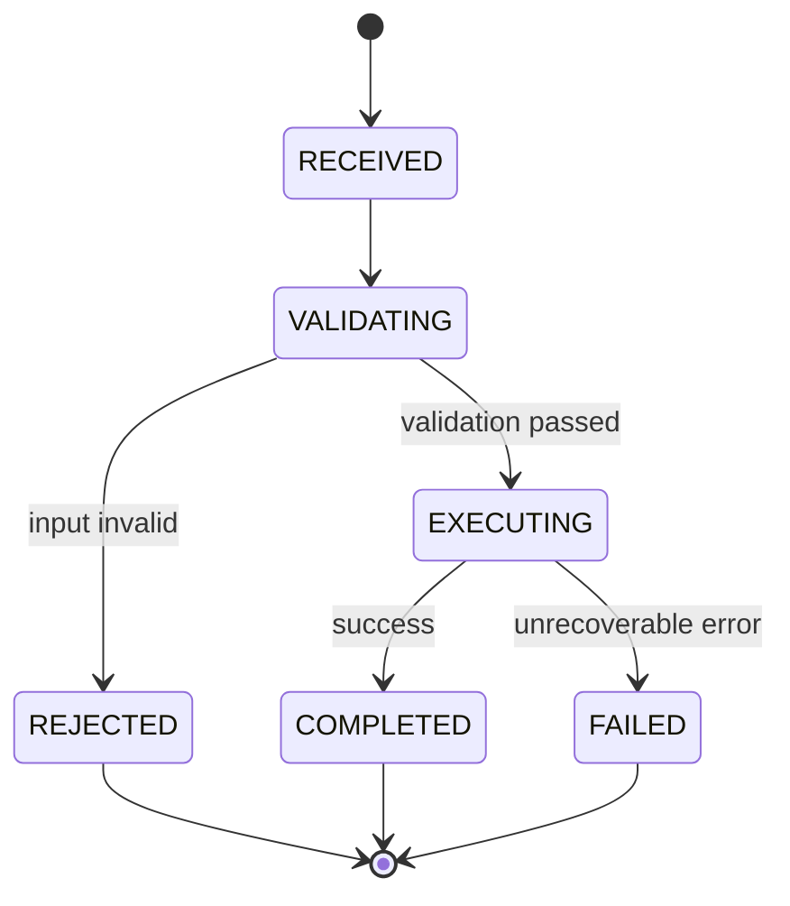
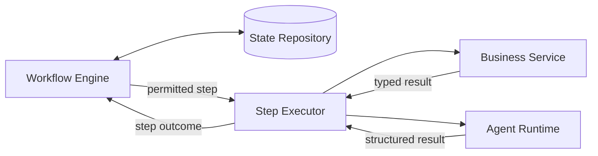
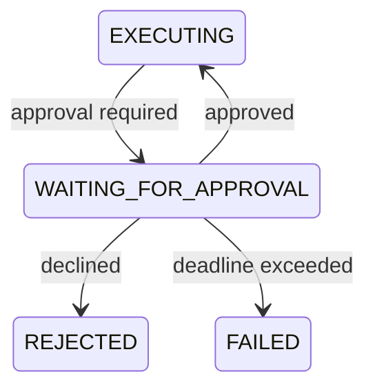

# Part 6.1 — Architecting Stateful Agentic Workflows

An agent can complete a tool call successfully and the overall business process can still fail.

The next service might time out. The process might restart before its state is saved. A retry might repeat a side effect. Or the agent might keep proposing actions without making progress.

Better prompting won't solve these problems on its own. They need workflow architecture.

The central idea is simple: **treat the workflow as a durable control plane, not a chain of agent callbacks.** The agent reasons about its task; the workflow engine owns process state, permitted transitions, recovery, and termination.

## 1. Model the workflow explicitly

Start with the states a business process can occupy and the transitions allowed between them.



This is intentionally a small example. A real workflow may need `WAITING`, `RETRYING`, or `COMPENSATING` states, but add them only when they represent a meaningful difference in behavior.

The state machine should answer three questions:

- Where is this execution now?
- Which transitions are legal from this state?
- What counts as a terminal outcome?

Here, `COMPLETED`, `FAILED`, and `REJECTED` are terminal. A terminal execution cannot quietly jump back into processing. If the business needs another attempt, create a new execution or define an explicit restart policy.

## 2. Keep control flow separate from business work

The workflow engine decides what is allowed to happen next. The step executor dispatches the selected step. Business services perform domain operations. The agent runtime handles model-driven work and returns a structured result.



This separation is more than tidy code organization. It establishes who owns each decision.

The agent may recommend an action, but it should not be allowed to rewrite workflow state or bypass a transition guard. The runtime validates the result against the workflow definition, permissions, and execution budgets before moving forward.

## 3. Define typed state and transition contracts

Avoid passing an unstructured dictionary between every component. Give each execution an ID, definition version, current state, iteration count, and the data needed to resume or audit it.

```python
from dataclasses import dataclass, field
from enum import Enum
from typing import Any


class State(str, Enum):
    RECEIVED = "RECEIVED"
    VALIDATING = "VALIDATING"
    EXECUTING = "EXECUTING"
    COMPLETED = "COMPLETED"
    REJECTED = "REJECTED"
    FAILED = "FAILED"


class ErrorCode(str, Enum):
    INVALID_TRANSITION = "INVALID_TRANSITION"
    INVARIANT_VIOLATION = "INVARIANT_VIOLATION"
    LOOP_LIMIT_EXCEEDED = "LOOP_LIMIT_EXCEEDED"
    TERMINAL_STATE = "TERMINAL_STATE"


@dataclass
class Workflow:
    workflow_id: str
    definition_version: int
    state: State = State.RECEIVED
    iteration: int = 0
    data: dict[str, Any] = field(default_factory=dict)
```

Keep transition rules in one place, rather than scattering them through callbacks:

```python
ALLOWED = {
    State.RECEIVED: {State.VALIDATING},
    State.VALIDATING: {State.EXECUTING, State.REJECTED},
    State.EXECUTING: {State.COMPLETED, State.FAILED},
    State.COMPLETED: set(),
    State.REJECTED: set(),
    State.FAILED: set(),
}
```

A transition should validate both the state graph and any invariant required by the target state:

```python
class WorkflowError(Exception):
    def __init__(self, code: ErrorCode, message: str):
        super().__init__(message)
        self.code = code


def transition(workflow: Workflow, target: State) -> None:
    terminal = {State.COMPLETED, State.REJECTED, State.FAILED}

    if workflow.state in terminal:
        raise WorkflowError(
            ErrorCode.TERMINAL_STATE,
            f"Workflow is already terminal: {workflow.state.value}",
        )

    if target not in ALLOWED[workflow.state]:
        raise WorkflowError(
            ErrorCode.INVALID_TRANSITION,
            f"{workflow.state.value} -> {target.value} is not allowed",
        )

    if target == State.EXECUTING and not workflow.data.get("validated"):
        raise WorkflowError(
            ErrorCode.INVARIANT_VIOLATION,
            "Execution requires validated input",
        )

    workflow.state = target
```

This is an in-memory teaching example, not a complete workflow engine. In a production implementation, persist the transition atomically and use optimistic locking or equivalent concurrency control. Otherwise, two workers could both read the same old state and attempt to advance it.

## 4. Choose the right kind of step

Not every step needs a model.

Use deterministic steps for schema validation, authorization, policy checks, and calculations that must follow fixed rules. They are easier to test and replay.

Agent steps are useful for interpreting ambiguous context, summarizing evidence, classifying unstructured input, or proposing a plan. Treat their output as a typed result and validate it before using it.

```python
def execute_step(step_type, payload, services, agent_runtime):
    if step_type == "validate_request":
        return services.validator.validate(payload)

    if step_type == "analyze_with_agent":
        result = agent_runtime.invoke(
            task="analyze_request",
            input=payload,
        )
        return validate_agent_result(result)

    raise ValueError(f"Unsupported step type: {step_type}")
```

`validate_agent_result` represents your application-specific schema and policy checks. The important point is the boundary: model output is input to the runtime, not permission to execute an action.

## 5. Bound loops and retries

Some workflows need repeated execution—for example, an agent may need another retrieval pass before it can produce an answer. Repetition must still have a defined limit.

```python
MAX_ITERATIONS = 4


def begin_iteration(workflow: Workflow) -> None:
    if workflow.iteration >= MAX_ITERATIONS:
        raise WorkflowError(
            ErrorCode.LOOP_LIMIT_EXCEEDED,
            "Workflow exceeded its iteration budget",
        )
    workflow.iteration += 1
```

Also set an overall deadline, per-step timeouts, and an explicit retry policy. Retry only failures that are safe to retry. A timeout does not prove that an external operation failed; it may have succeeded while the response was lost. Use idempotency keys or a reconciliation step before repeating side effects.

Conditional branches should be explicit too: validation passes → `EXECUTING`; validation fails → `REJECTED`. Avoid letting free-form model text decide the next workflow state.

## 6. Persist state and plan for recovery

Keep storage behind a repository interface so the engine does not depend on a particular database:

```python
from typing import Protocol


class WorkflowRepository(Protocol):
    def get(self, workflow_id: str) -> Workflow | None: ...
    def save(self, workflow: Workflow) -> None: ...
```

A production repository will usually need more than the current state: definition version, step attempts, timestamps, outputs or references to outputs, and failure details. It should also support atomic updates or concurrency checks.

After a restart, load the persisted execution, verify its definition version, and resume from a known safe boundary. Decide how external side effects are handled before replaying a step. Persistence alone does not guarantee safe recovery.

Versioning deserves attention as well. A workflow may remain active while application code changes. Keep the definition version attached to each execution and decide whether in-flight executions finish on their original version or move through a controlled migration.

## 7. Decide where execution boundaries belong

A workflow definition should distinguish a state transition from the work performed between transitions. For example, moving from `VALIDATING` to `EXECUTING` is a control-plane decision; calling a payment, search, or customer service is an execution step. Keeping these separate makes it possible to test the transition policy without invoking real services.

For long-running steps, do not keep a worker occupied while waiting for a human approval, an external event, or a slow job. Persist a waiting state and resume when the event arrives. The event handler should verify the workflow ID, expected state, and event identity before advancing the process. Duplicate or late events should be safe to reject or handle idempotently.

It is also useful to define the step's completion contract. A step should return a known outcome—such as `SUCCEEDED`, `RETRYABLE_FAILURE`, or `PERMANENT_FAILURE`—rather than forcing the engine to infer control flow from log messages or exception text. The workflow maps that outcome to a permitted transition. This keeps service-specific details out of the state machine.

## 8. Make workflow behavior observable

Persisting state tells you where an execution is now; operational telemetry helps explain how it got there. Record each transition with the workflow ID, definition version, previous and next states, step name, attempt number, timestamp, and outcome. Correlate those events with traces and logs from the services or agent runtime involved.

Avoid storing secrets, full prompts, or sensitive business payloads in transition logs by default. Prefer references to protected records and apply retention and access policies to workflow history. For agent steps, capture useful operational metadata—model/runtime version, latency, token usage where available, tool outcomes, and validation result—without treating model reasoning text as an authoritative audit record.

These records help answer practical questions: Which transition failed? Was a step retried? Did the external operation complete before a timeout? Which workflow-definition version was running? Without this context, a durable workflow can still be difficult to operate.

## 9. Model approval and external events as workflow states

Human approval is not just another tool call. It introduces a pause in execution, a decision made outside the worker, and the possibility that the response arrives late or more than once. Represent that boundary explicitly so the workflow can release its worker, persist progress, and resume safely.



The approval event should carry a workflow ID, a unique event ID, the expected current state, and the decision. Before applying it, the runtime checks that the workflow is still waiting for that approval and that the event has not already been consumed. This protects against stale approvals and duplicate delivery.

A small handler can make the guard explicit:

```python
def apply_approval(workflow, event, consumed_event_ids):
    if event.id in consumed_event_ids:
        return  # duplicate delivery; no second transition

    if workflow.state != State.WAITING_FOR_APPROVAL:
        raise WorkflowError(
            ErrorCode.INVALID_TRANSITION,
            "Workflow is not awaiting approval",
        )

    consumed_event_ids.add(event.id)
    target = State.EXECUTING if event.approved else State.REJECTED
    transition(workflow, target)
```

This is illustrative: the event-consumption record and state transition must be committed atomically in production. Otherwise, a crash between those writes can either lose the decision or apply it twice. Add `WAITING_FOR_APPROVAL` to the state enum and transition map when implementing this path; the sample above shows the handler contract, not a drop-in extension of the earlier minimal model.

The same pattern applies to callbacks from long-running jobs and external systems. Treat incoming events as untrusted inputs, validate their identity and expected state, then let the workflow engine decide whether the event is allowed to move the process forward.

Approval should also be scoped to the exact action being reviewed. Store a reference or hash for the proposed operation, the approver identity, decision timestamp, and policy or workflow version. If the proposal changes after approval, require a new decision rather than reusing the old one. Set an explicit deadline and define whether expiry means rejection, escalation, or a recoverable pause; never leave the execution waiting indefinitely.

## 10. Test the contracts—not just the happy path

At minimum, cover:

- Every permitted transition and each rejected transition.
- Invariant violations, including attempts to execute unvalidated input.
- Both outcomes of every conditional branch.
- Loop limits and timeout or retry behavior.
- Terminal states remaining terminal.
- Successful completion and failure paths.
- Persistence and recovery without skipping a guard.

These tests do not need to predict every model response. They need to prove that no model response can bypass the workflow's control contracts.

## 💼 Backend Architecture Parallel

Think of the workflow engine as the orchestration layer in a distributed backend system. Persisted workflow state resembles business-process state; transition guards enforce invariants; retries, idempotency, and recovery address familiar distributed-systems challenges.

Agentic AI adds model-driven decisions, but it does not remove the need for reliable state management or explicit control flow.

## Architecture Takeaway

**The agent reasons about its task. The workflow engine governs the process.**

Keep state, transition rules, recovery, and termination under explicit runtime control. That separation makes agentic systems easier to test, audit, and operate—and gives the system a predictable path when an agent or dependency does not behave as expected.


## Further Reading

For deeper coverage across AI Engineering—from ML and Deep Learning to LLMs, RAG, Generative AI, and Agentic AI—explore the AI Engineering Handbook for concepts, engineering patterns, architecture, and production considerations.

[Enterprise AI Handbook](https://enterpriseai.handbook.mihirkjha.com/)

> **Enterprise AI Engineering Handbook**
>
> *Building Production-Grade Enterprise AI Systems — One Chapter at a Time.*
