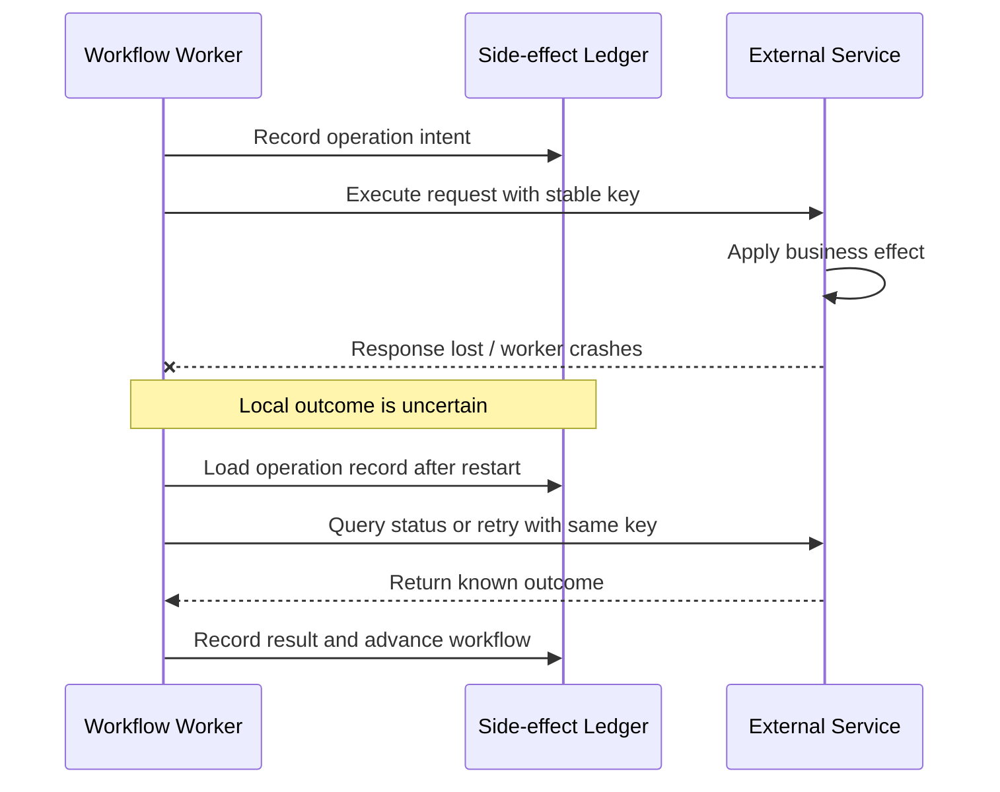
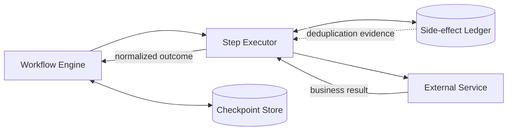
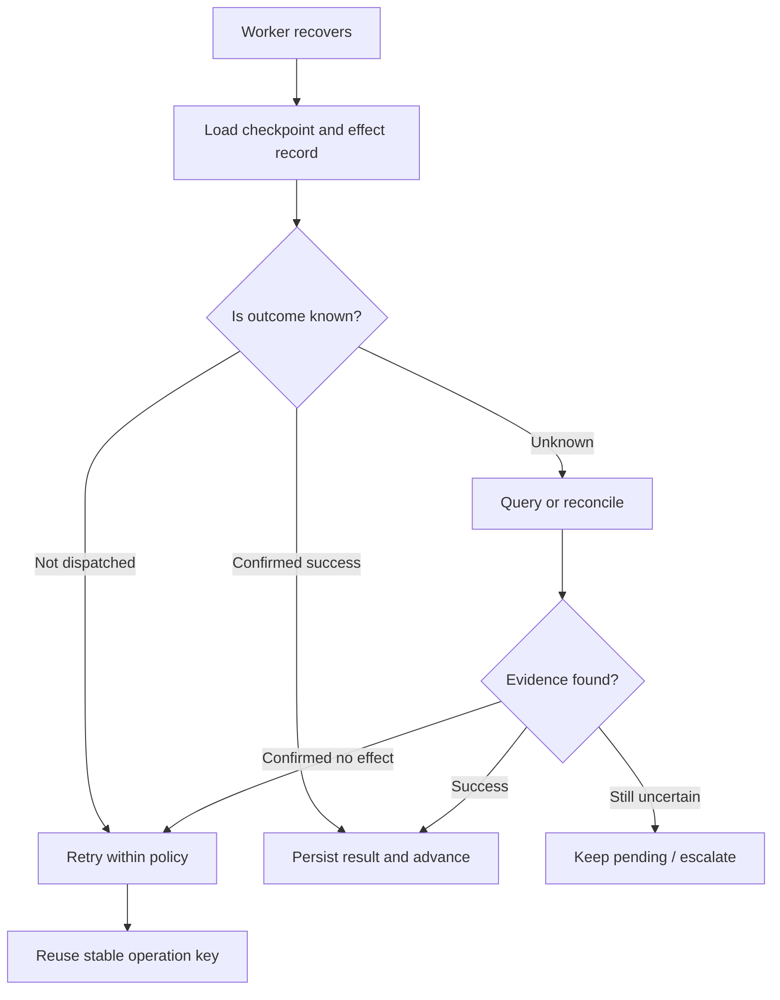

# Part 6.2 — Engineering Durable Agent Execution: Checkpoints, Idempotency & Crash Recovery

A workflow can have a sound state machine and still fail in production. An external service may complete a business action just before the worker crashes, leaving the workflow without a saved result.

On restart, local state cannot prove the action failed. Blindly repeating it might create a duplicate payment, order, notification, or ticket.

The goal of durable agent execution is simple: **recover from uncertainty, not merely restart code.** Part 6.1 established explicit workflow states and guarded transitions. This part extends them across persistence boundaries and external side effects. Define what the system knows, what it can safely repeat, and how it resolves unknown outcomes—without promising universal exactly-once execution.

## 1. Identify the failure window

Consider a workflow that invokes a service:

1. The worker records that a step is ready to execute.
2. It sends a request to the external service.
3. The service performs the business action.
4. The worker receives the response.
5. The workflow records the result and advances its state.

A crash can happen between any two of these points. The most important window is after the external action succeeds but before the local workflow records success. On recovery, local state may still say `IN_PROGRESS`, even though the business action has already happened.



A checkpoint helps resume from a known point; it cannot prove a remote side effect completed. That requires downstream evidence, idempotency, or reconciliation.

## 2. Separate workflow checkpoints from the side-effect ledger

These two records answer different questions.

- **Workflow checkpoint:** Where did the process stop? Which step was active? Which definition version and attempt were running?
- **Side-effect ledger:** What do we know about a particular business operation? Was it not dispatched, in progress, confirmed successful, permanently failed, or left with an unknown outcome?

Keep them distinct: a workflow can remain `EXECUTING` after a side effect completed but before that result was acknowledged.

Separate the workflow engine, checkpoint repository, step executor, side-effect ledger, and external service:



The engine owns state transitions and recovery decisions. The executor invokes business services. The checkpoint store persists workflow progress. The ledger tracks the lifecycle of an external operation. The receiving service must enforce its own idempotency contract if it is the boundary where duplicate effects can be prevented.

## 3. Give every logical operation a stable idempotency key

Idempotency means that repeating a request with the same logical identity does not repeat the protected business effect. The exact behavior depends on the downstream service, so the contract should be explicit.

A key should identify the logical operation—not the network attempt. For example, retrying the same order submission should reuse the same key. Creating a new key for every retry makes each request look like a new operation and defeats deduplication.

Derive a key from the workflow ID and a stable step or business-operation ID:

```python
def idempotency_key(workflow_id: str, operation_id: str) -> str:
    return f"{workflow_id}:{operation_id}"
```

In multi-tenant systems, scope keys by tenant and operation. The receiver should reject—or explicitly define behavior for—a reused key with a different payload. A key is not an authorization token.

Document key retention, duplicate-request behavior, and concurrent requests using the same key. Retention must cover the expected retry and recovery window.

## 4. Record side-effect status explicitly

A small ledger can model operation status separately from workflow status. The following is a teaching example; a production ledger needs durable storage, uniqueness constraints, atomic updates, and concurrency control.

```python
from dataclasses import dataclass
from enum import Enum
from typing import Any


class EffectStatus(str, Enum):
    PENDING = "PENDING"
    IN_PROGRESS = "IN_PROGRESS"
    SUCCEEDED = "SUCCEEDED"
    FAILED_FINAL = "FAILED_FINAL"
    UNKNOWN = "UNKNOWN"


@dataclass
class SideEffect:
    operation_key: str
    workflow_id: str
    status: EffectStatus = EffectStatus.PENDING
    result: Any = None
    attempt: int = 0
```

A timeout after dispatch should usually move the record to `UNKNOWN`, not `FAILED_FINAL`: the service may have acted even though no response arrived.

Keep reconciliation evidence: operation key, workflow/step IDs, timestamps, attempt count, downstream reference, outcome, and error class. Do not store secrets or unnecessary sensitive payloads.

## 5. Treat timeouts as uncertain outcomes

A timeout tells us that the caller did not receive a response within the expected period. It does not tell us whether the remote system performed the action.

A safe recovery policy distinguishes at least three cases:

- **Known not executed:** the request was never dispatched, or the system has reliable evidence that no effect occurred. A retry may be safe.
- **Known successful:** the downstream service or ledger confirms completion. Record the result and advance without repeating the effect.
- **Unknown:** the request may have succeeded, but the system lacks conclusive evidence. Query status, retry with the same idempotency key, or run reconciliation before deciding.



If supported, retrying with the same key may return the original result. Otherwise, use a status API, reconciliation, or manual review. Do not label an unknown outcome as failure just to make the state look tidy.

## 6. Define retry, resume, and compensation separately

These terms describe different recovery actions.

- **Resume** continues from a persisted safe boundary without repeating completed work.
- **Retry** makes another attempt at an operation that is safe to repeat under the defined contract.
- **Reconcile** gathers evidence to determine what happened when the outcome is uncertain.
- **Compensate** performs a new business action to counteract an earlier completed action.

Bound retries by attempt count, deadline, error class, and backoff. Validation failures and authorization denials are usually terminal. A transient network error may be retryable, but first consider whether the side effect already occurred.

Compensation is not a database rollback across services. A refund, cancellation, or reversal is another business operation, with its own permissions, failure modes, and audit requirements. Define when compensation is allowed and what happens if it fails. Some effects—such as an already delivered notification—may not be reversible at all.

## 7. Make the execution path recovery-aware

This example illustrates the control flow, not a complete transaction protocol. Production ledger operations need atomicity and must align with the downstream idempotency contract.

```python
def execute_durable(step, ledger, service):
    key = step.idempotency_key
    record = ledger.get(key)

    if record and record.status == EffectStatus.SUCCEEDED:
        return record.result

    if record and record.status in {
        EffectStatus.IN_PROGRESS, EffectStatus.UNKNOWN
    }:
        # Claim/reconcile atomically in production; do not race another worker.
        outcome = service.lookup_operation(key)
        if outcome.is_success:
            ledger.mark_succeeded(key, outcome.result)
            return outcome.result
        if not outcome.confirmed_not_executed:
            raise RecoveryRequired(key)

    # Must be an atomic claim/transition in the production ledger.
    ledger.mark_in_progress(key, step.workflow_id)

    try:
        result = service.execute(
            step.payload,
            idempotency_key=key,
        )
    except TimeoutError:
        ledger.mark_unknown(key)
        raise RecoveryRequired(key)

    ledger.mark_succeeded(key, result)
    return result
```

A crash can still occur after the service completes but before `mark_succeeded` commits. Downstream idempotency or status lookup is what closes that gap; ledger transitions must also handle worker races.

Protect the ledger with a unique constraint on the operation key and use optimistic locking, leases, or equivalent concurrency controls. Claim work atomically so two workers cannot both own the same pending step. Pass the same key on every attempt. A database transaction can protect workflow state and ledger updates only when they share that database; it cannot make a remote API call atomic.

## 8. Checkpoint versioning and replay boundaries

A workflow may outlive the code version that created it. Store the definition version with each checkpoint and decide whether in-flight executions stay on that version or undergo an explicit migration.

Replay needs boundaries. Pure calculations and deterministic validation are often safe to repeat. External writes, emails, payments, and ticket creation need idempotency or reconciliation. Resume from a recorded step boundary and re-evaluate steps with uncertain outcomes instead of replaying the full history.

## 9. Test failure windows with evidence

Happy-path tests do not establish durability. Inject failures at the boundaries where workflow state and external effects can diverge.

Test these cases:

- Crash before dispatch: no business effect should occur.
- Crash after the external service succeeds but before the local result is saved.
- Response timeout when the service actually completed the operation.
- Duplicate message delivery and repeated worker resume.
- Two workers attempting to recover the same execution.
- A permanent failure that must not be retried.
- A compensation attempt that itself fails.
- Recovery of an execution created under an older workflow-definition version.

Acceptance evidence should be tied to a defined boundary. For example: “For a given tenant and operation key, the downstream business action is applied at most once, and repeated requests return or reconcile to the recorded outcome.” This is a meaningful guarantee only if the receiving service actually enforces it. Without downstream idempotency or equivalent coordination, a local checkpoint alone cannot prove at-most-once effects.

## 💼 Backend Architecture Parallel

This is a familiar distributed-systems problem. A local transaction cannot include a remote API call automatically. Messages can be redelivered, responses lost, and workers restarted after a side effect but before recording it.

Checkpoints track process progress. Idempotency protects a business-operation boundary. A side-effect ledger preserves evidence, while reconciliation resolves uncertainty. These mechanisms work together, but none should be described as a universal exactly-once switch.

## Architecture Takeaway

Durable execution is not about preventing every failure. It is about making recovery predictable when failures happen.

Treat workflow progress and external side effects as related but distinct records. Reuse stable idempotency keys, represent unknown outcomes honestly, and define when the system resumes, retries, reconciles, or compensates. Then test the crash windows—not just the successful path.

The most useful production guarantee is not “the workflow never fails.” It is a precise statement of what the system will and will not repeat when it recovers.

## Further Reading

For deeper coverage across AI Engineering—from ML and Deep Learning to LLMs, RAG, Generative AI, and Agentic AI—explore the AI Engineering Handbook for concepts, engineering patterns, architecture, and production considerations.

[Enterprise AI Handbook](https://enterpriseai.handbook.mihirkjha.com/)

> **Enterprise AI Engineering Handbook**
>
> *Building Production-Grade Enterprise AI Systems — One Chapter at a Time.*
