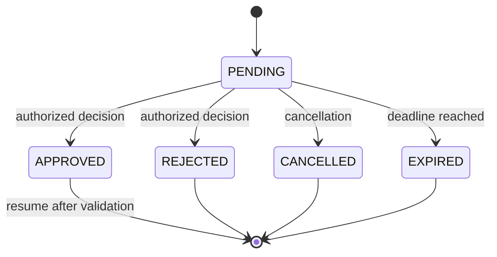
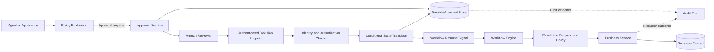

# Designing Human Approval Workflows for Enterprise AI: Identity, Policy & Safe Resumption

## 1. The architectural problem

Imagine an AI agent preparing a payment. A manager approves it, but before the workflow resumes, the payment details change.

Should the agent still go ahead?

This is the real challenge in human-in-the-loop architecture. Collecting an approval is straightforward. Ensuring that the approval is still valid, authorized, and enforced when the action executes is harder.

Human approval must be treated as an authorization boundary in the execution architecture—not merely as a button in the UI or a boolean field in workflow state.

The key separation is:

- **The model recommends** an action.
- **Policy defines** what is permitted and under which conditions.
- **An authenticated, authorized human makes** the approval decision when required.
- **The workflow enforces** the decision before execution.

Keep these responsibilities explicit and testable.

## 2. Treat approval as a first-class workflow resource

A long-running workflow should not keep an HTTP request open while it waits for a person. Instead, persist the approval request and move the workflow into a state such as `PENDING_APPROVAL`.

Give the approval a stable ID and record the request, eligible approver, expiry, and applicable policy.

A useful conceptual contract is:

```python
from dataclasses import dataclass
from datetime import datetime
from enum import Enum
from typing import Optional


class ApprovalStatus(str, Enum):
    PENDING = "PENDING"
    APPROVED = "APPROVED"
    REJECTED = "REJECTED"
    CANCELLED = "CANCELLED"
    EXPIRED = "EXPIRED"


@dataclass(frozen=True)
class ApprovalRequest:
    approval_id: str
    workflow_id: str
    request_version: str
    payload_hash: str
    status: ApprovalStatus
    expires_at: datetime
    policy_version: str
    approver_id: Optional[str] = None
    decided_at: Optional[datetime] = None
```

This is a domain sketch, not a persistence implementation. Enforce valid transitions and uniqueness constraints in the persistence layer too.

### Why not a boolean?

A field such as `approved = True` hides important distinctions. It does not tell the system whether the request was rejected, cancelled, expired, or approved by an authorized person against the correct request version.

Explicit states make the lifecycle inspectable and testable.

## 3. Model the approval lifecycle

The workflow should support explicit transitions and reject invalid ones.



Add states such as `RESUMING` or `REQUIRES_REAPPROVAL` only when they represent distinct, documented behavior.

Each transition needs guards. For example:

- Only an authorized caller may record a decision.
- Decisions are accepted only while the approval is pending.
- Expired approvals cannot be accepted.
- A decision must refer to the correct approval and request version.
- Competing decisions must not both become final.

State names alone enforce none of these rules.

## 4. Keep identity, policy, and model reasoning separate

An agent can prepare a payment or recommend a configuration change. That does not give it the authority to execute the action.

Validate the person and decision independently of model reasoning.

### Identity and authorization checks

Depending on the action and the organization's controls, verify:

- The approver's authenticated identity.
- The approver's role and action-level permissions.
- Whether the person is allowed to approve this specific request.
- Whether separation-of-duties rules apply.
- Whether the approval deadline has passed.
- Which policy version governed the decision.

For sensitive operations, the person who approves may need to be different from the person who initiated the request.

The model cannot approve its own action. A model-generated “approved” is not evidence of an authorized human decision.

## 5. Bind approval to the exact request

An approval should authorize a specific action and request version—not an evolving request.

Consider this example:

| Field | Approved request | Execution candidate |
|---|---|---|
| Version | `v17` | `v18` |
| Recipient | Supplier A | Supplier B |
| Amount | $8,000 | $18,000 |
| Approval | Approved | Not approved |

If the recipient or amount changes after approval, the workflow must detect the difference. Depending on policy, it should reject the stale approval and request a new decision.

A payload hash helps detect changes only when calculated from a canonical representation of the authorized fields. Policy—not the hash—determines which changes are material.

Before execution, compare the approved version or payload fingerprint with the current request. Never silently reuse a mismatched approval.

## 6. Make approval decisions idempotent and concurrency-safe

Approval callbacks can arrive more than once. Two requests may even try to approve and reject the same action at nearly the same time.

A check followed by a separate write is not enough: concurrent requests can both read `PENDING` before either records a result.

Use a stable `approval_id`, an idempotent decision contract, and a conditional state transition backed by database concurrency control.

Conceptually:

```sql
UPDATE approval_requests
SET status = :decision,
    approver_id = :approver_id,
    decided_at = CURRENT_TIMESTAMP
WHERE approval_id = :approval_id
  AND status = 'PENDING'
  AND expires_at > CURRENT_TIMESTAMP;
```

Inspect the affected-row count and handle each outcome deliberately:

- **One row updated:** the transition succeeded.
- **No row updated:** the approval may already be decided, expired, missing, or otherwise ineligible; load the current record and return the appropriate result.
- **Duplicate delivery of the same decision:** return the recorded outcome where the caller is authorized to see it.
- **Conflicting decision:** reject it without overwriting the first accepted decision.

This SQL is illustrative. Use supported database syntax, validate the caller and request version, and enforce the transition atomically.

## 7. Resume the workflow as a controlled operation

Recording `APPROVED` should not itself trigger an unguarded business action. Resumption is another controlled step.

A safe resumption path should:

1. Load the current workflow and approval records.
2. Verify the approver and decision are valid for this request.
3. Check expiry and confirm the approved request version still matches.
4. Re-evaluate any authorization conditions that must hold at execution time.
5. Determine whether the business operation has already completed or is still in progress.
6. Execute through a protected business boundary, using idempotency or reconciliation where supported.
7. Persist the outcome and connect it to the audit trail.

The approval and business services may use separate transactions. If a worker crashes after the business action succeeds but before recording completion, a missing response does not prove failure.

Approval controls and side-effect recovery solve related but distinct problems: approval authorizes an action; idempotency and reconciliation protect execution from duplicate effects.

## 8. Reference architecture



The boundaries are deliberate:

- **Policy evaluation** determines whether approval is required and what constraints apply.
- **Approval service** owns the approval resource and its decision lifecycle.
- **Identity and authorization** validate who is making the decision and what they can approve.
- **Workflow engine** owns workflow state and decides when execution may resume.
- **Business service** enforces business invariants and performs the action.
- **Audit trail** links the decision, policy, workflow, and resulting business operation.

The approval service should not become a substitute for business authorization, and the workflow engine should not treat a model response as an approval event.

## 9. Audit evidence should answer real questions

An audit record should help an operator or reviewer answer: who approved what, under which policy, and what happened afterward?

Useful fields include:

| Field | Purpose |
|---|---|
| `approval_id`, `workflow_id` | Connect the decision to the workflow |
| `request_version` or `payload_hash` | Identify the exact approved action |
| `approver_id` and authorization context | Establish who made the decision |
| `decision`, `decided_at`, `expires_at` | Record the outcome and its timing |
| `policy_version` | Explain which policy governed the decision |
| `correlation_id` | Connect approval events to execution traces |
| `execution_status` and business reference | Show what happened after approval |

Protect audit evidence from unauthorized changes and follow retention and privacy requirements. Do not copy secrets or unnecessary personal data into logs.

## 10. Failure scenarios to test

Approval flows should be tested as distributed workflows, not only as UI interactions.

| Scenario | Expected behavior |
|---|---|
| Request changes after approval | Detect the mismatch; require reapproval when policy says so |
| Decision arrives after expiry | Reject it and preserve evidence |
| Same callback arrives twice | Return the recorded result without applying the decision twice |
| Approve and reject arrive concurrently | Allow only one valid transition to win |
| Unauthorized person submits a decision | Reject the request and record the security-relevant outcome |
| Worker restarts while approval is pending | Recover from persisted state |
| Workflow resumes after the business action completed | Reconcile or deduplicate; do not repeat the effect |
| Policy or permissions change before execution | Revalidate according to the defined execution-time policy |

Test both API responses and persisted state. For concurrency, exercise overlapping requests against the real persistence mechanism or a suitable integration environment.

## 💼 Backend Architecture Parallel

This is familiar backend engineering applied to an AI-driven workflow.

A long-running process should not hold an HTTP connection open while waiting for a human. Persist the state, expose an approval resource, process decisions through guarded transitions, and resume asynchronously.

The same principles used in reliable backend systems apply here:

- State transitions should have explicit contracts.
- Concurrent updates need concurrency control.
- Repeated events need idempotent handling.
- Recovery must distinguish an unknown outcome from a confirmed failure.
- Business services must continue to enforce their own invariants.

The AI element changes how a request may be proposed, but it does not remove the need for durable state, authorization, or reliable execution.

## Architecture Takeaway

Human approval is not just a UI feature. It is an authorization boundary in the execution architecture.

The model recommends. Policy defines what is permitted. An authenticated, authorized human makes the decision. The workflow enforces it.

A safe design binds the decision to the exact request, persists it as a controlled state transition, and verifies it again before execution resumes. It also accounts for expired approvals, duplicate callbacks, concurrent decisions, worker restarts, and business operations whose outcome is uncertain.

The goal is not simply to collect a human click. It is to make sure the system executes only an action that is still authorized—and can explain later why it was allowed to proceed.


## Further Reading

For deeper coverage across AI Engineering—from ML and Deep Learning to LLMs, RAG, Generative AI, and Agentic AI—explore the AI Engineering Handbook for concepts, engineering patterns, architecture, and production considerations.

[Enterprise AI Handbook](https://enterpriseai.handbook.mihirkjha.com/)

> **Enterprise AI Engineering Handbook**
>
> *Building Production-Grade Enterprise AI Systems — One Chapter at a Time.*
