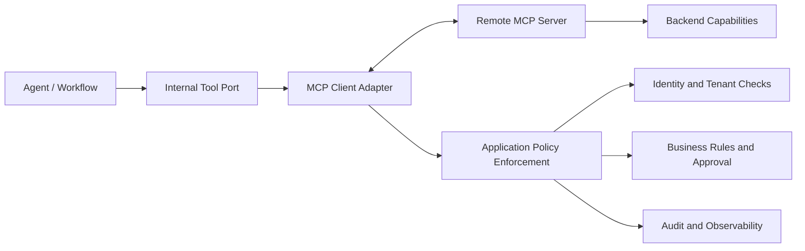

# Integrating MCP: Tool Discovery, Contract Validation & Trust Boundaries

## 1. The Architecture Problem

Imagine an AI agent discovers a payment tool through the Model Context Protocol (MCP). The connection works, the tool is listed, and its input schema looks valid. Should the agent be allowed to make the payment?

Not automatically. A server can expose a capability without every client, user, or workflow being entitled to use it. This distinction matters when agents interact with customer records, financial operations, internal APIs, or other sensitive systems.

MCP gives AI applications a standard way to connect with tools and context sources. It does not replace application authorization, tenant isolation, business policy, human approval, or workflow state management. Those responsibilities remain with the platform and the services that own the business operation.

The design goal is straightforward: **use MCP as an integration boundary, not as a shortcut around application policy.**

## 2. Give Each Layer a Clear Job

The MCP client connects to a server, discovers capabilities, sends requests, and handles results and protocol errors. Depending on the transport and deployment, it also manages connection lifecycle and session-related concerns. The MCP server exposes supported capabilities and describes their interfaces; it may offer tools, resources, and prompt templates.

The surrounding application still has important jobs:

- **Agent or workflow:** decides when a capability is relevant and owns execution state, deadlines, retries, and approval pauses.
- **Internal tool port:** defines stable request and result types for business logic.
- **MCP client adapter:** translates between the internal contract and MCP-specific requests and responses.
- **Application policy:** checks identity, tenant scope, data access, business permissions, and approval requirements.
- **Backend service:** protects its own business invariants and data integrity.

Without these boundaries, workflows can become coupled to remote protocol details, and teams may accidentally treat discovery as permission. Keep the protocol translation in one adapter and make policy checks explicit at execution time.

## 3. Reference Architecture



This is a logical view; actual policy enforcement may happen in more than one place. The application should authorize a request before execution, and the backend should continue to enforce the invariants for the resource it owns. A remote server's capability list must not override the platform's own policy.

For a sensitive action, the workflow can prepare a request, pause for approval, revalidate the request, and then invoke the tool. An MCP response must not silently skip those workflow transitions.

## 4. Discovery and Contract Validation

Discovery tells a client which capabilities a server exposes and provides interface details such as tool input schemas. It does not mean every discovered capability should be available to every workflow. Keep discovery bounded to the capabilities the platform intends to support, and use an allowlist where appropriate.

A practical adapter should:

1. Discover the relevant capabilities.
2. Check that the requested capability is supported by platform policy.
3. Validate arguments before invocation.
4. Map the request to the internal typed contract.
5. Validate or normalize the result before returning it to business logic.
6. Treat incompatible schema changes as explicit integration failures.

Schema validation checks shape and types; it does not prove that an action is legitimate. A schema-valid payment may still exceed a limit, target a blocked recipient, or violate tenant policy. Those checks belong to the application and the service that owns the business operation.

### Example: an internal tool contract

The following Python example illustrates a platform contract, not a complete MCP SDK implementation:

```python
from dataclasses import dataclass
from typing import Any, Mapping

@dataclass(frozen=True)
class ToolContext:
    tenant_id: str
    principal_id: str
    correlation_id: str
    deadline_epoch_ms: int

@dataclass(frozen=True)
class ToolRequest:
    capability: str
    arguments: Mapping[str, Any]
    context: ToolContext

@dataclass(frozen=True)
class ToolResult:
    content: Mapping[str, Any]
    correlation_id: str
```

This gives business logic a consistent request shape whether the capability is implemented locally or exposed by a remote MCP server. Validate values at runtime; do not accept tenant identity from model-generated arguments, and keep credentials and sensitive payloads out of logs. In a real implementation, use the MCP SDK for protocol operations and map its types into your own stable contract.

The adapter then resolves the requested capability against the discovered, supported set; validates arguments; invokes the MCP tool; and converts the result or failure into the platform's result model. Business workflows should not need to understand every protocol-specific error.

## 5. Tools, Resources, and Prompts

MCP primitives serve different purposes:

- **Tools** support operations a client can invoke—for example, looking up an order or creating a support ticket.
- **Resources** expose data or context, such as policy documents or reference records.
- **Prompts** provide reusable prompt templates for a client interaction.

Choose the primitive that matches the use case. Reading a resource can still disclose sensitive information, even if it does not modify state. A prompt can influence model behavior, but it does not grant permission to perform the actions it describes. A tool can cause side effects and may therefore need stricter authorization and audit controls.

Treat content returned by a remote server as data, not as trusted instructions. Validate it for its intended use and keep policy enforcement outside model-generated text.

## 6. Discovery, Authentication, and Authorization Are Different

These three questions need separate answers:

- **Discovery:** What capabilities does the server expose?
- **Authentication:** Which client or principal is connecting, and how has its identity been established?
- **Authorization:** May this principal perform this operation, for this tenant and resource, right now?

A successful discovery response answers only the first question. A working connection does not prove that a business action is allowed.

At execution time, evaluate the trusted principal, tenant context, requested capability, resource scope, business rules, and risk level. For sensitive actions, check whether approval is required and whether the approval still applies to the exact request being executed.

Tenant identity should come from trusted application context, not a model-generated argument. Likewise, the server's list of tools should not override the platform's capability policy. Backend services should enforce their own invariants instead of relying only on an upstream agent.

## 7. Local Adapter or Remote MCP Server?

Neither option is universally better. The right choice depends on deployment ownership, reuse, trust, and operational needs.

| Dimension | Local adapter | Remote MCP server |
|---|---|---|
| Deployment | Often released with the application | Can be deployed and reused independently |
| Coupling | Close to application runtime | Clear network and protocol boundary |
| Trust | May be easier to inspect in a controlled deployment | Needs explicit trust and identity controls |
| Failure | Fewer network-related failure modes | Network latency, timeouts, remote outages |
| Compatibility | Often versioned with the application | Requires server and schema evolution management |
| Isolation | Shares some process/deployment boundaries | Can isolate runtime, but adds a remote dependency |

A remote server can improve reuse and independent deployment, but it introduces another operational dependency. A local adapter can simplify debugging and release coordination, but may tie its lifecycle to the application. Choose based on the trust model and failure-isolation needs, not on a blanket preference for local or distributed systems.

## 8. Timeouts, Retries, and Failure Isolation

Remote calls fail in ways that can be easy to misread. A server may be unavailable, respond after the caller's deadline, or complete a side effect while its response is lost.

Use explicit deadlines and bounded timeouts. Normalize transport and protocol errors into a stable internal model, so the workflow does not need to handle every remote error shape. Log enough to diagnose failures, but avoid credentials, secrets, and unnecessary personal data.

Retries need particular care. A timeout does not prove that the operation failed. A read-only request may be safe to retry within policy and deadline limits. For side-effecting operations, use idempotency keys where supported, operation identifiers, or backend reconciliation before retrying. Otherwise, a payment or ticket could be created twice.

The adapter should return a controlled failure or an explicit unknown-outcome status. The workflow then decides whether to retry, reconcile, compensate, ask for human intervention, or stop. Do not leave recovery decisions hidden inside the adapter. For every side-effecting capability, document which outcomes are retryable, which require reconciliation, and which must stop for an operator. That contract should be tested alongside the adapter, not left as an assumption in a runbook.

## 9. Context Propagation and Observability

A remote boundary should not break the context needed to explain what happened. Carry correlation IDs, tracing context, tenant and principal information, deadlines, and audit references through the adapter according to the platform's trust model.

Propagate only the identity context the remote service needs. Do not treat an arbitrary value returned by a server as a trustworthy identity claim. Keep logs useful but appropriately redacted.

Useful telemetry includes request duration, timeout and error rates, schema-validation failures, denied calls, retry counts, and capability usage. Audit records should connect the initiating principal, requested capability, policy decision, approval where relevant, and resulting operation. This helps teams understand not only whether a protocol call succeeded, but whether the business action was allowed and what happened afterward.

## 10. Test the Boundary, Not Just the Happy Path

A successful discovery-and-call test is not enough. Include tests for failure and security cases:

| Test | Expected behavior |
|---|---|
| Schema drift | Detect incompatible fields or types and fail safely |
| Invalid arguments | Reject missing, malformed, or out-of-policy values |
| Denied capability | Stop when identity, tenant, or policy checks fail |
| Remote timeout | Enforce the deadline and represent uncertain outcomes explicitly |
| Error normalization | Map transport/protocol failures to stable internal errors |
| Trace propagation | Preserve correlation and tracing context across the adapter |
| Duplicate side effect | Prevent unsafe repeat execution after a timeout |
| Approval required | Block execution until the required approval is valid |

Also test server unavailability, malformed results, and policy changes between discovery and execution. Permissions can change after a capability has been discovered, so the application must evaluate current policy when the operation is requested.

## 11. 💼 Backend Architecture Parallel

This is much like integrating an external service into a microservice platform. We isolate protocol details in an adapter, validate contracts at the boundary, enforce permissions in the application, and plan for timeouts and partial failures.

MCP gives the integration a standard protocol; it does not remove the usual engineering responsibilities for security, reliability, observability, and business correctness.

## 12. Architecture Takeaway

MCP helps agents discover and communicate with external capabilities, but it does not replace the application's security or workflow architecture.

- The client discovers capabilities.
- The adapter validates schemas and maps the internal contract.
- The application checks authorization, tenant scope, data policy, and approval.
- The workflow controls execution and recovery.
- Observability and audit connect the request to the outcome.

**Discovery tells us what's available. Policy decides what's permitted.**

That distinction is easy to miss in a prototype—and essential when an AI system starts doing real business work.

## 13. Further Reading

For deeper coverage across AI Engineering—from ML and Deep Learning to LLMs, RAG, Generative AI, and Agentic AI—explore the AI Engineering Handbook for concepts, engineering patterns, architecture, and production considerations.

[Enterprise AI Handbook](https://enterpriseai.handbook.mihirkjha.com/)

> **Enterprise AI Engineering Handbook**
>
> *Building Production-Grade Enterprise AI Systems — One Chapter at a Time.*
