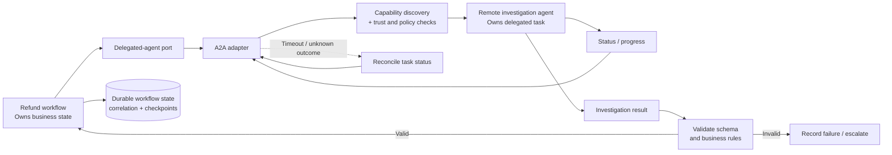
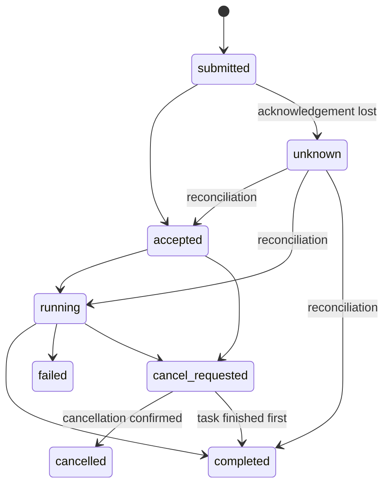

# A2A Protocol in Enterprise AI: Discovery, Delegation, and Reliable Task Lifecycles

An enterprise AI workflow may need to delegate work to a specialist agent owned by another team or service. The challenge is not just sending a request. The caller must know which agent is suitable, track the delegated task, handle uncertain outcomes, validate the returned result, and resume the business process safely.

The **Agent-to-Agent (A2A) protocol** provides an interoperability boundary for agents to discover capabilities and collaborate on tasks. But a protocol alone does not guarantee reliable business execution. That depends on the architecture around it: authorization, durable state, correlation, recovery, and result validation.

This guide uses a refund-investigation workflow to show how to design that boundary without giving a remote agent uncontrolled ownership of the business process.

## 1. A2A and MCP Solve Different Problems

A2A and the Model Context Protocol (MCP) serve different integration needs.

| Concern | A2A | MCP |
|---|---|---|
| Primary purpose | Agent-to-agent interoperability and task delegation | Access to tools, resources, and context |
| Typical interaction | Delegate a task to a specialist agent and track its outcome | Discover and invoke an exposed tool or access context |
| Main design question | Who owns the delegated task, and how does the result return? | What capabilities or context can the client access? |

They can coexist. An agent may use MCP to access approved tools and A2A to delegate a task to another agent.

Not every multi-agent design needs A2A. If two components share one application lifecycle and the interaction is a straightforward internal call, a direct function or workflow invocation may be simpler. Use a protocol boundary when independent deployment, ownership, or interoperability justifies its operational cost.

## 2. Reference Architecture: Refund Investigation

Suppose a refund workflow needs evidence about a disputed transaction. It delegates investigation to a specialist agent, which returns an assessment. The caller then validates that assessment and applies its own refund policy.



**Ownership is deliberately split:**

- **Refund workflow:** Owns the refund's business state, deadlines, approval policy, checkpoints, and recovery decisions.
- **Delegated-agent port:** Defines the internal contract the workflow uses to submit, inspect, and cancel delegated work.
- **A2A adapter:** Maps the internal contract to the chosen A2A implementation and normalizes its responses and errors.
- **Remote investigation agent:** Owns execution of the investigation task within the agreed scope.
- **Durable state store:** Persists the workflow run, correlation, remote task reference, observed state, and recovery information.
- **Result validation:** Ensures the returned assessment is structurally valid and acceptable under business rules before the workflow resumes.

This separation keeps protocol details out of business orchestration and prevents a remote agent from becoming the authority for the refund decision.

## 3. Discovery Is Not Authorization

Capability discovery can help identify an agent that advertises transaction-investigation functionality. It does not prove the agent is trusted, available, or authorized for the requested data and action.

Before delegation, check:

1. **Capability fit:** Does the agent support the task required?
2. **Identity and endpoint trust:** Is this the expected agent or service?
3. **Delegation authorization:** Is this caller allowed to delegate this task to this agent?
4. **Data minimization:** Does the request contain only the information required for investigation?
5. **Action boundaries:** Is the remote agent permitted to investigate, but not to issue the refund itself?

The caller should pass only the necessary transaction context and retain control of the business decision. A remote agent's recommendation is evidence for the workflow—not automatic authorization to perform a high-impact action.

## 4. Model the Task Lifecycle Explicitly

Remote work may finish quickly or continue asynchronously. The caller needs a durable record of what it knows about the task, not just a pending HTTP request.

An internal lifecycle can use states such as:

- `submitted` — the caller is attempting to submit the task.
- `accepted` — the remote side has acknowledged it.
- `running` — work is in progress.
- `completed` — a result is available for validation.
- `failed` — the remote task reports a terminal failure.
- `cancel_requested` — cancellation was requested but is not yet confirmed.
- `cancelled` — cancellation is confirmed.
- `unknown` — the caller cannot currently establish the remote outcome.

These are illustrative internal states, not a claim that every A2A implementation uses these exact names or transitions. Map the selected protocol's task states and update mechanisms into the application's model.



The `unknown` state is essential. A timeout means the caller did not observe a response in time; it does not prove the remote agent failed. The task may have been accepted or completed even though its acknowledgement was lost.

## 5. Keep a Protocol-Neutral Delegation Contract

The workflow should depend on an internal port rather than protocol-specific request and response types. The adapter translates between that port and the actual A2A client/API.

```python
from typing import Any, Protocol

class DelegatedAgentPort(Protocol):
    async def submit_task(
        self,
        task: dict[str, Any],
        correlation_id: str,
    ) -> str:
        """Submit work and return the remote task ID."""
        ...

    async def get_status(
        self,
        remote_task_id: str,
    ) -> dict[str, Any]:
        """Return a normalized state and any available result."""
        ...

    async def cancel_task(
        self,
        remote_task_id: str,
    ) -> None:
        """Request cancellation; confirmation may be asynchronous."""
        ...
```

This is an illustrative **application-level contract**, not an official A2A SDK interface. In a real implementation, replace the broad dictionaries with typed submission, status, result, and error models. The adapter should normalize protocol-specific task states, transport errors, and result payloads.

Persist enough information to recover safely:

- workflow run ID and correlation/trace ID;
- remote agent identity or endpoint reference;
- remote task ID, once known;
- submission time and deadline;
- last observed task state;
- retry and reconciliation history;
- validated result reference, cancellation status, or escalation reason.

Avoid logging credentials or unnecessary customer data.

## 6. Recover Safely from Timeouts and Duplicate Submissions

Consider the refund workflow submitting an investigation task. The remote agent accepts the request, but the acknowledgement is lost. The caller times out before receiving a remote task ID.

Retrying immediately could create a second investigation. A correlation ID helps link events, but it does **not** guarantee deduplication unless the receiving side supports and enforces the necessary semantics.

A safer approach is:

1. Persist the intended delegation and a stable correlation identifier.
2. Submit the task and save the remote task ID as soon as it is received.
3. If the outcome is uncertain, reconcile using a supported correlation or idempotency mechanism.
4. Retry only when the system can establish that doing so is safe.
5. If the remote outcome cannot be established, retain an `unknown` state and continue reconciliation or escalate according to policy.

If the remote implementation offers no way to look up an uncertain submission and no idempotency support, the caller cannot promise exactly-once execution. That limitation should be explicit in the design.

Cancellation has a similar uncertainty: a cancellation request does not prove the remote task has stopped. A late result must not overwrite a newer workflow decision. Check the current workflow state or version before accepting it.

## 7. Validate the Result Before Resuming

A `completed` status only indicates that the remote task finished according to the remote system. It does not prove the result is correct or safe to use.

For the refund-investigation example, validate two levels:

**Structural validation**
- Required fields and types are present.
- The result matches the expected schema and size limits.
- The result is associated with the expected task and transaction.

**Business validation**
- Required evidence is included.
- The assessment complies with business and data policies.
- The result does not bypass refund limits or required human approval.

A simplified application flow might look like this:

```python
async def resume_refund_workflow(workflow, agent, task_id, validator):
    status = await agent.get_status(task_id)

    if status["state"] in {
        "submitted", "accepted", "running", "unknown"
    }:
        return workflow.wait_or_reconcile(status)

    if status["state"] == "failed":
        workflow.record_agent_failure(task_id, status)
        return workflow.apply_failure_policy()

    if status["state"] != "completed":
        workflow.record_unexpected_state(task_id, status)
        return workflow.escalate()

    result = status.get("result")
    try:
        validated_result = validator.validate(result)
    except ValueError as exc:
        workflow.record_invalid_result(task_id, str(exc))
        return workflow.escalate()

    workflow.record_investigation(task_id, validated_result)
    return workflow.evaluate_refund_policy(validated_result)
```

The `workflow` and `validator` methods are illustrative application methods. Adapt them to your persistence layer, schema library, and selected A2A implementation. In particular, handle the actual validation exceptions raised by your chosen library. The key rule is that validation precedes business resumption.

## 8. Observability and Failure Testing

Trace the delegation across the caller, adapter, remote task, and result hand-back. Useful telemetry includes workflow run ID, correlation ID, remote task ID, agent identity, submission and completion times, task state, reconciliation count, timeout, cancellation and validation outcomes.

Measure delegation latency, completion and failure rates, unknown outcomes, invalid results, and manual escalations. Keep high-cardinality IDs in traces or structured logs rather than unbounded metric labels. Do not place secrets or unnecessary customer data in telemetry.

Test failure paths as part of adapter contract and workflow integration tests:

| Scenario | Expected behavior |
|---|---|
| No suitable agent discovered | Use an approved fallback or fail clearly |
| Delegation denied | Do not submit; record the denial |
| Acknowledgement lost | Reconcile before unsafe resubmission |
| Progress delayed | Retain durable state; don't infer failure |
| Remote task fails | Apply bounded retry, fallback, or escalation policy |
| Cancellation races with completion | Resolve state without overwriting a newer decision |
| Result is invalid | Reject it and prevent workflow resumption |
| Agent becomes unavailable | Preserve recoverable state and reconcile later |
| Late result arrives | Check workflow state/version before accepting it |

A successful demo is not enough. The system should be able to explain what happened, recover where possible, and escalate when the remote outcome remains uncertain.

## 9. When to Use A2A

Use A2A when independent agents need a defined interoperability boundary for delegated tasks, especially across separately deployed services, teams, or technology stacks.

Prefer a direct internal workflow call when the interaction is local, simple, and does not need independent discovery or delegated-task tracking. The objective is not to make every component an agent; it is to choose the smallest boundary that meets the system's actual ownership and interoperability needs.

## Frequently Asked Questions

### What is the A2A protocol used for in enterprise AI?
A2A supports task-oriented interoperability between agents. Durable workflow state, authorization, recovery, and result validation remain application architecture responsibilities.

### What is the difference between A2A and MCP?
A2A focuses on agent-to-agent delegation and interoperability; MCP focuses on access to tools, resources, and context. An architecture may use both.

### Does A2A guarantee exactly-once execution?
Do not assume it does. Safe retry behavior depends on the full system, including the receiving side's idempotency or deduplication support and the caller's ability to reconcile uncertain outcomes.

### Who owns the business process after delegation?
The caller's workflow should retain ownership of business state, approvals, and recovery. The remote agent owns the execution of its delegated task within the agreed scope.

## Architecture Takeaway

**The remote agent owns its task. The calling workflow owns the business process.**

A2A provides an interoperability boundary; reliable enterprise delegation depends on explicit ownership, secure capability selection, durable task correlation, careful recovery, and validated results.

---

## Further Reading

For deeper coverage across AI Engineering—from ML and Deep Learning to LLMs, RAG, Generative AI, and Agentic AI—explore the AI Engineering Handbook for concepts, engineering patterns, architecture, and production considerations.

[Enterprise AI Handbook](https://enterpriseai.handbook.mihirkjha.com/)

> **Enterprise AI Engineering Handbook**
>
> *Building Production-Grade Enterprise AI Systems — One Chapter at a Time.*
