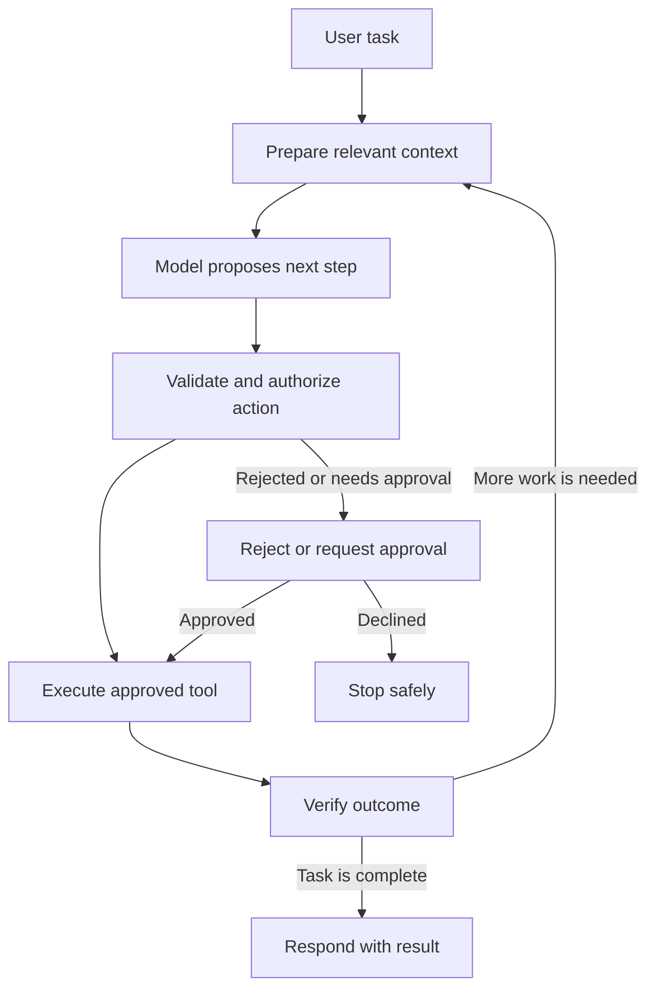
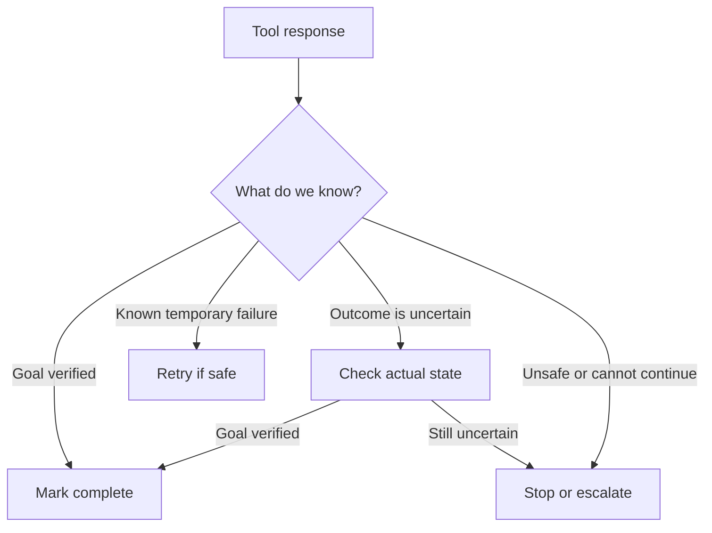
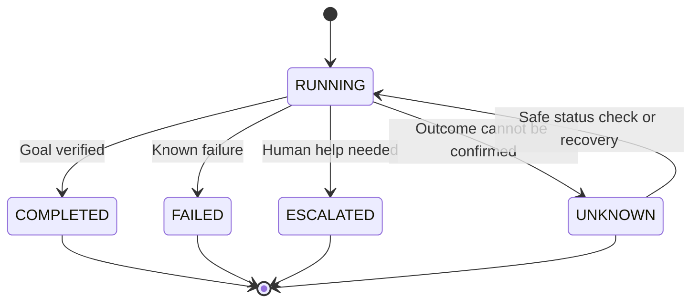

# 5.0 — Anatomy of an AI Agent Harness

## 1. What Is an AI Agent Harness?

An **AI agent harness** is the software around an AI model that manages how an agent works. It gives the model access to approved tools, checks which actions are allowed, tracks progress, handles failures, and verifies whether the task is actually complete.

A model can suggest what to do next, but a production application needs more than a suggestion. It must execute actions safely, respect permissions, handle timeouts, and report the outcome honestly.

Imagine a customer asks, “Where is my refund?” The model may decide to check the order and payment systems. The harness calls the appropriate tools, checks their results, and determines whether the available information answers the question.

A useful way to think about it is:

**AI agent = model + harness + environment**

- **Model:** interprets the task and proposes the next step.
- **Harness:** manages context, decisions, tools, rules, and recovery.
- **Environment:** the APIs, databases, services, and other systems the agent interacts with.

The model can be flexible in how it reasons. The harness must be predictable about how actions are checked and executed.

## 2. How an Agent Harness Works

An agent harness usually follows a simple loop: understand the task, prepare relevant context, ask the model for a next step, check the proposed action, execute it if permitted, and verify the result.

### 2.1 From task to action



The model proposes an action; it does not grant itself permission to perform it. The harness checks the action before execution. If the action is not allowed, it should be rejected or sent for approval instead of being run.

### 2.2 Four checks before a tool runs

These checks solve different problems:

1. **Tool allowlist:** Is this tool available to the agent at all?
2. **Input validation:** Are the tool name and arguments valid and well-formed?
3. **Authorization:** Is this user or agent allowed to perform this operation on this resource?
4. **Human approval:** Does this particular action require a person to confirm it?

For example, an agent may be allowed to use an order-status tool. That does not mean every user can inspect every order. The application must check the user's access to the specific order. A refund operation may also require a separate approval step based on business policy.

These checks should be enforced by application code, not by asking the model whether an action is safe.

### 2.3 Check whether the task really succeeded

A successful tool call does not always mean the user's task is complete. An API may return an error, a request may time out, or the result may not answer the original question.



The harness should not report success just because it sent a request. It should verify the result against the task's goal. If it cannot establish what happened, it should say so.

## 3. The Main Responsibilities of a Harness

### Runtime and task state

The runtime controls the agent loop and tracks the task's progress. It records which step is running, what the model proposed, which tools were called, and what each tool returned.

It should also maintain a clear task status. A simple lifecycle might be:



These are application-level task states, not labels the model gets to choose without checks:

- **RUNNING:** work is in progress.
- **COMPLETED:** the goal has been verified.
- **FAILED:** the system knows the task could not be completed.
- **ESCALATED:** a person must review or decide what happens next.
- **UNKNOWN:** an action may have succeeded, but the system cannot confirm its outcome.

The runtime also needs limits, such as a maximum number of steps, execution time, and cost. These limits prevent endless loops and uncontrolled spending.

### Context and memory

The model needs relevant information to make a useful decision. The harness prepares context from the user's request, previous steps, tool results, and any permitted memory.

More context is not always better. Irrelevant history can increase cost and make decisions less clear, so the context builder should select information that helps with the current task.

Treat external content as data, not automatically as instructions. A retrieved document, email, or tool response may contain misleading or malicious text. The harness should not let that content override system rules or grant new permissions.

### Tools and contracts

Tools connect the agent to real systems, such as order services, search, databases, or internal APIs. Each tool should have a clear purpose and a defined input and output contract.

For example, `check_refund(order_id)` should accept a valid order identifier and return a structured status. It should not accept arbitrary commands or silently perform a different operation.

Validate tool arguments before execution and validate responses before using them. A model-generated argument is still untrusted input.

### Policy and safe execution

The policy layer determines whether an action is permitted. The execution layer runs the approved operation and handles practical concerns such as timeouts, rate limits, errors, and service availability.

Keep these responsibilities separate. A tool being on the allowlist does not prove the current user is authorized to use it. Human approval also does not replace normal authorization checks.

Actions that change data or move money need stronger safeguards than read-only actions. For sensitive operations, use least-privilege credentials and require explicit approval where business policy demands it.

### Verification and recovery

Verification checks whether the result matches the original task. Depending on the task, that may mean checking a service response, reading the updated state, validating a value, or asking a person to review an uncertain outcome.

Recovery logic decides whether to retry, perform a safe status check, use another approved path, ask for clarification, escalate, or stop. A retry is appropriate only when the failure is understood and repeating the operation will not cause an unwanted duplicate action.

### Observability and evaluation

Logs and traces help developers understand an individual run. Useful details include the task ID, tool name, execution duration, outcome, retry count, and failure reason. Avoid logging secrets or unnecessary personal data.

Observability answers, “What happened in this run?” Evaluation answers, “How well does this agent perform across many runs?” Evaluation can measure task success, incorrect tool choices, policy violations, latency, and cost using representative test cases.

## 4. A Small Orchestration Example

This Python example shows the basic control flow without hiding the key responsibilities inside a large framework.

```python
MAX_STEPS = 5
ALLOWED_TOOLS = {"read_order", "check_refund"}


def run_agent(task, user, model, tools, policy, verify):
    history = []

    for _ in range(MAX_STEPS):
        action = model.propose(task, history)

        # Check that the proposed tool and arguments are valid.
        if action.name not in ALLOWED_TOOLS:
            return {"status": "FAILED", "reason": "Tool not allowed"}

        if not tools.validate_arguments(action):
            return {"status": "FAILED", "reason": "Invalid arguments"}

        # Enforce access rules in application code.
        if not policy.is_authorized(user, action):
            return {"status": "FAILED", "reason": "Not authorized"}

        try:
            result = tools.execute(action)
        except tools.KnownTemporaryError:
            return {"status": "FAILED", "reason": "Tool execution failed"}

        verdict = verify(task, result)
        history.append({
            "tool": action.name,
            "result": result,
            "verdict": verdict,
        })

        if verdict == "success":
            return {"status": "COMPLETED", "history": history}

        if verdict == "uncertain":
            return {"status": "UNKNOWN", "history": history}

        if verdict == "stop":
            return {"status": "ESCALATED", "history": history}

    return {"status": "FAILED", "reason": "Step limit reached"}
```

The example demonstrates a few important ideas:

- The loop has a fixed step limit.
- Only approved tool types are available.
- Arguments and user permissions are checked before execution.
- Tool execution failures are not treated as successful results.
- The task is marked complete only after verification.
- An uncertain outcome is not reported as success.

This is illustrative pseudocode, not a drop-in production implementation. In a real system, `tools`, `policy`, and `verify` must be implemented with reliable application logic. Tool exceptions need structured handling, and a timeout may leave the operation's outcome unknown rather than proving that it failed.

For operations that change state, use idempotency keys where supported and check the operation's status before retrying. For high-impact actions, add an explicit approval workflow. The application—not model output—must enforce these controls.

## 5. Common Failure Cases

| Failure | What the harness should do |
|---|---|
| The model proposes an unknown tool | Reject the action and record the reason. |
| Tool arguments are invalid | Validate inputs and return a clear error. |
| The user lacks permission | Deny the action, even if the tool is generally allowed. |
| A request times out after changing data | Check the operation's status before retrying. |
| The result is ambiguous | Verify actual state or escalate; do not claim success. |
| The agent repeats the same step | Detect repeated actions and stop or change strategy. |
| The task exceeds its limits | Stop safely and report that the task is incomplete. |
| External content contains instructions | Treat it as untrusted data and keep policy controls in force. |

A reliable harness does not hide every failure. It makes failures bounded, understandable, and recoverable where possible.

## 6. 💼 Backend Architecture Parallel

An AI agent harness has many responsibilities that are familiar from conventional backend systems.

| Backend engineering concept | Agent harness equivalent |
|---|---|
| Request handler | Receives the task and starts the run |
| Workflow or state machine | Controls the agent loop and task state |
| Context or request builder | Selects the information sent to the model |
| API client | Calls an approved tool or external service |
| Access-control layer | Checks identity, permissions, and allowed actions |
| Validation layer | Checks tool arguments and returned data |
| Retry and timeout policy | Handles temporary failures and limits repeated work |
| Business-rule validation | Verifies that the outcome satisfies the task |
| Logs, metrics, and tracing | Makes individual runs observable |
| Test and evaluation pipeline | Measures agent behavior across representative tasks |

Consider a refund workflow. A conventional backend can implement the refund rules directly. An agent can help interpret the customer's request and choose which approved operation to perform, but the backend must still enforce refund eligibility, authorization, and financial rules.

That is the key architectural distinction: **use the model for flexible interpretation and planning; use ordinary application code for deterministic controls and critical business rules.**

## 7. Agent Harness Review Checklist

Before deploying an agent workflow, ask:

- [ ] Is the goal and stopping condition clear?
- [ ] Are the available tools explicitly allowlisted?
- [ ] Are tool arguments and responses validated?
- [ ] Are user identity and permissions checked by application code?
- [ ] Are high-impact actions subject to the right approval rules?
- [ ] Are retrieved content and tool responses treated as untrusted input?
- [ ] Are step, time, and cost limits configured?
- [ ] Are retries safe, especially for actions that change state?
- [ ] Does the system distinguish failure from an unknown outcome?
- [ ] Is task completion verified against the original goal?
- [ ] Can uncertain or high-impact cases be escalated to a human?
- [ ] Can the team inspect failures without exposing secrets?
- [ ] Are representative tasks used to evaluate quality, safety, latency, and cost?

## 8. Key Takeaway

An AI model can reason about what should happen next, but reasoning alone does not make a reliable application. The harness turns model decisions into controlled execution: it prepares context, checks proposed actions, enforces boundaries, handles failures, and verifies outcomes.

**The model proposes. The harness controls. The environment provides the real outcome.**

That separation is the foundation of a dependable agent system.

---
## 9. Further Reading

For deeper coverage across AI Engineering—from ML and Deep Learning to LLMs, RAG, Generative AI, and Agentic AI—explore the AI Engineering Handbook for concepts, engineering patterns, architecture, and production considerations.

[Enterprise AI Handbook](https://enterpriseai.handbook.mihirkjha.com/)

> **Enterprise AI Engineering Handbook**
>
> *Building Production-Grade Enterprise AI Systems — One Chapter at a Time.*
---