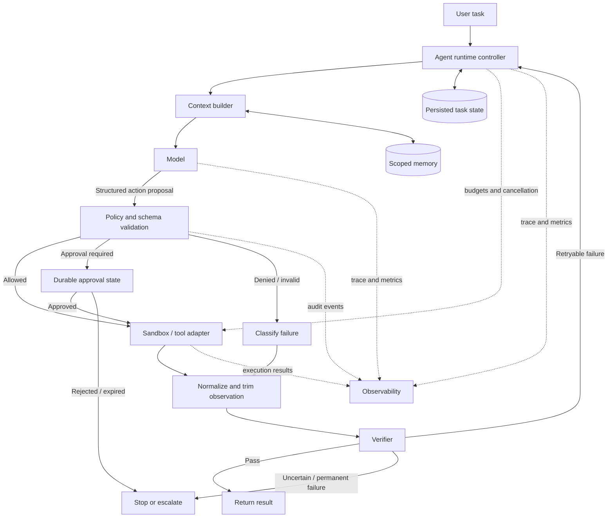

# Anatomy of an AI Agent Harness
*Enterprise AI Systems Architecture Stack · Architecture Insights*

## Why capable models still fail at tasks

An AI model can produce a convincing plan and still fail to complete the job. It may call the wrong tool, lose a critical detail in a long context, repeat a side effect, or declare success before checking the result.

The missing piece is often the runtime around the model.

A useful architectural lens is:

> **Agent = Model + Harness + Environment**

The model interprets context and proposes the next step. The **harness** manages the loop: assembling context, validating actions, enforcing limits, executing tools, collecting evidence, and deciding whether to continue. The **environment** supplies the actual systems and constraints—files, APIs, data, identities, and runtime conditions.

This is a design lens rather than a universal taxonomy. Frameworks group these responsibilities differently, but the responsibilities still need to exist somewhere.

## Reference architecture



The boxes are logical responsibilities, not necessarily separate microservices. Start with clear module boundaries; split components into services only when isolation, scaling, security, or operational ownership justifies it.

## Architectural responsibilities

### 1. Runtime controller and task state

The controller owns the agent loop. It decides when a new model turn may start, which result returns to the model, and when the run must stop. Enforce maximum iterations, elapsed time, token or monetary budgets, cancellation, and retry policy in trusted code—not in model instructions.

Persist task state when a run must survive restarts, wait for human approval, or resume after a long-running operation. Store the current step, relevant artifacts, approval status, and budget usage. Do not assume every agent needs a distributed workflow engine; choose durability based on the task's failure and recovery requirements.

### 2. Context builder

Build each model turn from the task goal, system instructions, available tool schemas, current state, and selected observations. More context is not automatically better.

- Rank evidence by relevance and freshness.
- Summarize older history while preserving constraints and decisions.
- Separate temporary scratch notes from durable project knowledge.
- Treat retrieved content and tool output as untrusted data; do not let them override trusted instructions.

### 3. Model and tool contracts

The model reasons about the next step and proposes an action. A tool registry defines the capabilities available to it. Give each tool a narrow purpose, typed inputs, bounded outputs, and predictable error contracts. Prefer a `run_tests(target)` capability over unrestricted shell access when it meets the requirement.

Validate structured output before dispatch. Invalid arguments should produce a controlled error or another model turn, not an uncontrolled execution attempt.

### 4. Policy gate and human approval

Authorize every action against the caller's identity, resource scope, and policy. Separate three outcomes:

- **Allow:** the action is within the granted scope.
- **Require approval:** a defined human decision is needed.
- **Deny:** the action is prohibited or cannot be authorized.

Approval should be a workflow state with an owner, expiry, audit record, and a safe resume path. A model's statement that an action is necessary is not authorization.

### 5. Execution boundary

Execute approved operations through a controlled runner or tool adapter. Restrict filesystem access, network egress, credentials, process execution, resource use, and runtime. The boundary should return structured results, including exit status, timeout state, and relevant artifacts.

Sandboxing limits the blast radius; it does not replace authorization, input validation, or auditing.

### 6. Observation management and verification

Tool output can overwhelm the next model turn. Normalize it into a bounded observation containing the outcome, key errors, relevant excerpts, and links or references to retained artifacts. Keep the raw output where policy permits, but don't send all of it back to the model by default.

Verification checks independent evidence against the task's acceptance criteria. For a code change, that might include targeted tests, lint results, and a review of the diff. If a test runner times out, the result is **unknown**, not “passed.” If an external operation may have succeeded despite a lost response, avoid blindly repeating it.

### 7. Memory, subagents, and observability

Memory should be scoped, traceable, and refreshable. Store provenance and timestamps where useful; stale or conflicting notes should not silently become truth. Subagents can help with independent tasks, but require bounded permissions, explicit delegation, and a clear merge strategy. Parallel work can increase latency, coordination overhead, and cost rather than reduce them.

Tracing should correlate model calls, tool calls, retries, approvals, verification outcomes, and artifacts under a run ID. Capture latency, token use, failures, and cost while applying appropriate redaction and retention policies.

## A bounded orchestration example

This Python example shows a deliberately small runtime loop. The model adapter, sandbox, and verifier are injected dependencies. It demonstrates bounded retries and explicit stopping; it is **not** a complete security implementation.

```python
from dataclasses import dataclass
from typing import Any, Callable

@dataclass
class ToolCall:
    name: str
    arguments: dict[str, Any]

@dataclass
class Observation:
    status: str
    summary: str
    data: dict[str, Any]

MAX_STEPS = 6
ALLOWED_TOOLS = {"run_tests", "read_file"}

def validate_call(call: ToolCall) -> bool:
    if call.name not in ALLOWED_TOOLS:
        return False

    if call.name == "run_tests":
        return call.arguments.get("target") in {"checkout", "payments"}

    if call.name == "read_file":
        path = call.arguments.get("path", "")
        # Illustrative input restriction only. The actual file adapter
        # must enforce canonical-path and filesystem-boundary checks.
        return (
            isinstance(path, str)
            and path.startswith("src/")
            and ".." not in path.split("/")
        )

    return False

def run_agent(
    propose_action: Callable[[list[dict[str, Any]]], ToolCall],
    execute_in_sandbox: Callable[[ToolCall], Observation],
    verify: Callable[[Observation], str],
) -> dict[str, Any]:
    history: list[dict[str, Any]] = []

    for step in range(1, MAX_STEPS + 1):
        call = propose_action(history)

        if not validate_call(call):
            observation = Observation(
                status="denied",
                summary="Tool or arguments rejected by runtime policy",
                data={"tool": call.name},
            )
        else:
            observation = execute_in_sandbox(call)

        # The production implementation should sanitize and bound this
        # observation before adding it to model context or trace storage.
        history.append({
            "step": step,
            "tool": call.name,
            "status": observation.status,
            "summary": observation.summary,
            "data": observation.data,
        })

        verdict = verify(observation)

        if verdict == "pass":
            return {"status": "complete", "steps": step, "history": history}

        if verdict in {"stop", "uncertain"}:
            return {
                "status": "escalate",
                "reason": verdict,
                "steps": step,
                "history": history,
            }

        # Only a classified, retryable outcome should continue.
        if verdict != "retry":
            return {"status": "failed", "steps": step, "history": history}

    return {"status": "budget_exhausted", "steps": MAX_STEPS, "history": history}
```

The key separation is that the model proposes; the runtime validates and controls execution; the verifier evaluates evidence. In a real implementation, the loop also needs elapsed-time and cost budgets, cancellation, typed errors, trace correlation, durable state where required, and idempotency or reconciliation for side-effecting tools.

## Failure semantics are part of the design

| Situation | Runtime response |
|---|---|
| Invalid tool or arguments | Reject; return a structured error |
| Authorization denied | Stop that action; record the decision |
| Tool timeout with no side effect | Retry only if policy and budget allow |
| External side effect with unknown outcome | Reconcile state before retrying |
| Verification failure | Return relevant evidence for a bounded retry |
| Human approval pending | Persist state and resume after decision or expiry |
| Step, time, or cost limit reached | Stop cleanly and report incomplete status |

Retries are not a generic resilience strategy. They are safe only when the operation is retryable, the budget permits it, and duplicate effects are controlled. For APIs that create payments, tickets, or deployments, use idempotency keys or reconciliation rather than assuming a timeout means nothing happened.

## 💼 Backend Architecture Parallel

Agent harness design has close parallels with backend and distributed systems:

- The **tool registry** resembles an API contract with typed requests and responses.
- The **policy gate** resembles authorization middleware and admission control.
- The **runtime controller** resembles a workflow orchestrator with explicit state transitions.
- The **execution boundary** resembles an isolated worker or job runner.
- The **observation layer** resembles response normalization and structured logging.
- The **verifier** resembles postcondition checks and business-rule validation.
- **Tracing** connects a logical request across model, tool, and infrastructure boundaries.

The extra challenge is dynamic control flow: the next operation may depend on a model-generated proposal. That makes least privilege, bounded execution, explicit failure semantics, and evidence-based completion central architectural concerns.

## Architecture review checklist

Before shipping an agent workflow, ask:

1. What is the maximum step, time, and cost budget?
2. Which identities and resources can each tool access?
3. Which actions need approval, and how does a paused run resume?
4. Which operations can be retried safely, and how are uncertain side effects reconciled?
5. What evidence proves success—and what status represents an unknown outcome?
6. Can an operator reconstruct a run from traces without exposing secrets?
7. Which state must persist across process restarts, and how long should it be retained?

## Key takeaway

Do not evaluate an agent only by the quality of its model responses. Evaluate whether its runtime can constrain actions, recover from failure, preserve useful state, and prove completion.

**The model supplies reasoning. The harness supplies control. The environment supplies real-world consequences.** Design all three as one system, with explicit boundaries between them.


## Further Reading

For deeper coverage across AI Engineering—from ML and Deep Learning to LLMs, RAG, Generative AI, and Agentic AI—explore the AI Engineering Handbook for concepts, engineering patterns, architecture, and production considerations.

[Enterprise AI Handbook](https://enterpriseai.handbook.mihirkjha.com/)

> **Enterprise AI Engineering Handbook**
>
> *Building Production-Grade Enterprise AI Systems — One Chapter at a Time.*
