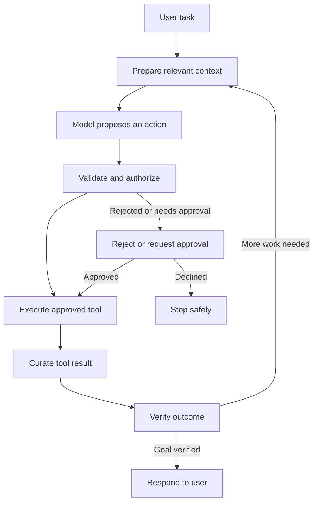
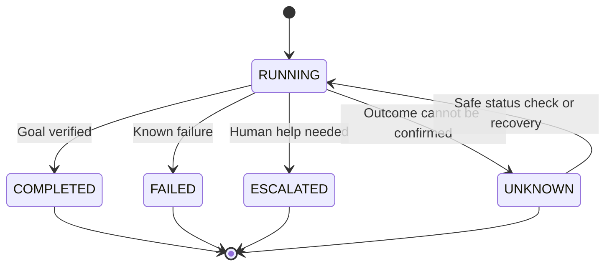

# 5.0 — Anatomy of an AI Agent Harness

## 1. What Is an AI Agent Harness?

An **AI agent harness** is the software around an AI model that manages how an agent works. It prepares relevant context, gives the model access to approved tools, checks proposed actions, tracks progress, handles failures, and verifies whether the task is complete.

A model can suggest what to do next, but a production application needs more than a suggestion. It must execute actions safely, respect permissions, handle timeouts, and report outcomes honestly.

Imagine a customer asks, “Where is my refund?” The model may decide to check the order and payment systems. The harness calls the approved tools, checks their results, and determines whether the information answers the question.

A useful mental model is:

**AI agent = model + harness + environment**

- **Model:** interprets the task and proposes the next step.
- **Harness:** manages context, tools, rules, execution, and recovery.
- **Environment:** the APIs, databases, services, and other systems the agent interacts with.

The model can be flexible in how it reasons. The harness must be predictable about how actions are checked and executed.

## 2. How an Agent Harness Works

The harness follows a loop: prepare context, ask the model for a next step, check the proposed action, execute it if permitted, inspect the result, and decide what happens next.



The model proposes an action; it does not grant itself permission to perform it. The harness checks the action before execution. If the action is not allowed, it must be rejected or sent for approval.

### Four checks before a tool runs

These checks solve different problems:

1. **Tool allowlist:** Is this tool available to the agent at all?
2. **Input validation:** Are the tool name and arguments valid?
3. **Authorization:** Is this user or agent allowed to perform this operation on this resource?
4. **Human approval:** Does this action require a person to confirm it?

For example, an agent may be allowed to use an order-status tool, but that does not mean every user can inspect every order. The application must check access to the specific order. A refund operation may also need approval under business policy.

These checks belong in application code, not in a model's own judgment.

## 3. Context Engineering Is Runtime Engineering

The model can only use the information it receives. The harness should select context deliberately instead of sending every available detail into every model call.

A useful starting point is to separate context into three groups:

| Context type | Examples | Purpose |
|---|---|---|
| Baseline instructions | System rules, task goal, repository conventions | Establish the rules and goal |
| Working evidence | Relevant files, recent tool outputs, errors, test results | Support the current decision |
| Persistent knowledge | Project notes, past decisions, constraints | Preserve useful information across tasks |

For example, when an agent fixes a failing test, it may need the repository's coding rules, the relevant source file, and the latest test error—not the entire repository history.

To manage the context budget:

- Rank information by relevance to the current task.
- Summarize old history when it is no longer needed in full.
- Preserve critical requirements and constraints.
- Keep task scratch notes separate from durable project knowledge.
- Store important decisions with their source or reason, and refresh facts that may become stale.

Treat retrieved documents, emails, and tool outputs as **untrusted data**, not as instructions that can override system rules or grant new permissions.

## 4. Tools Need Clear Contracts

Tools connect the agent to real systems, such as files, search, databases, or internal APIs. Expose a small, explicit set of capabilities rather than unrestricted access to everything.

For example:

```python
read_file(path)
search_docs(query)
run_tests(target)
edit_file(path, patch)
```

Each tool should have a defined purpose, input schema, output format, and clear error behavior. Validate arguments before execution and validate responses before using them. Model-generated arguments are still untrusted input.

A tool call should also be bounded and auditable: define what it can access, how long it may run, and what result it returns.

## 5. Policy and Safe Execution

The harness should check the proposed action before it reaches a real system.

A simple policy model is:

- **Allow:** read an approved file or run a scoped test.
- **Review:** edit a protected configuration or perform a high-impact operation.
- **Deny:** access credentials without permission or delete broad, unrelated paths.

The exact rules depend on the application. Access to sensitive data is not automatically a human-approval case; it first depends on the user's identity, permissions, and the relevant policy.

Keep four controls distinct: the allowlist decides which tools exist, validation checks the arguments, authorization checks access, and approval confirms actions that require human review.

### Run tools inside a controlled boundary

Generated commands and tool outputs can be unsafe or unreliable. Where applicable, use a controlled execution environment with:

- A scoped workspace and clear file read/write boundaries.
- Restricted network access and isolated secrets.
- Timeouts, quotas, and resource limits.
- Least-privilege credentials and audit logs.

Do not put secrets in model prompts when the tool can access them securely through the application. A successful tool launch is not proof that the task succeeded; capture the exit status, artifacts, and meaningful diagnostics.

## 6. Return Useful Observations, Not a Wall of Logs

Tool output becomes part of the evidence the model uses for its next decision. Sending too much output can waste context and hide the important detail.

A useful pattern is **capture → curate → return**:

1. **Capture:** retain the actual result, including exit status, errors, and relevant artifacts.
2. **Curate:** extract the details needed for the next decision.
3. **Return:** give the model a concise observation without hiding critical failures.

For example, instead of sending thousands of lines of test output, the harness might return:

```text
Status: FAILED
Failing test: RefundServiceTest.shouldHandleTimeout
Error: Expected UNKNOWN, received FAILED
Relevant file: RefundServiceTest.java
Next step: Inspect timeout handling and the related test.
```

This is an illustrative example, not output from a real test run. Preserve enough raw evidence for debugging and audit. A summary must not silently drop critical errors or make an uncertain result look successful.

## 7. Verify the Outcome

Do not accept the model's claim as proof that the task is complete. Verification should check the result against the original goal.

For a coding agent, useful checks include:

- **Tests:** Did the expected tests pass?
- **Regression:** Did the change introduce new failures or lint issues?
- **Change review:** Does the diff match the intended scope?
- **Acceptance:** Are the original task requirements met?

For a refund agent, verification might mean checking the payment system's actual refund status rather than relying on the fact that a refund request was sent.

If verification fails, the harness can feed the relevant evidence back into another step, retry when safe, escalate to a person, or stop. The right choice depends on what is known about the failure.

## 8. Track Task State and Handle Failures

A simple task lifecycle makes the agent's status clear:



- **RUNNING:** work is in progress.
- **COMPLETED:** the goal has been verified.
- **FAILED:** the system knows the task could not be completed.
- **ESCALATED:** a person needs to review or decide what happens next.
- **UNKNOWN:** an action may have succeeded, but the system cannot confirm its outcome.

The runtime should also set limits for steps, execution time, and cost. These prevent endless loops and uncontrolled spending.

### Retry carefully

Not every failure should trigger another attempt. If a test fails, the harness may safely return the error to the model. If a refund or payment request times out, the operation may already have succeeded.

Before retrying an action that changes state:

1. Check the operation's status if possible.
2. Use an idempotency key when the API supports it.
3. Retry only when doing so is safe.
4. If the outcome remains unclear, mark it `UNKNOWN` and escalate rather than claiming success.

## 9. Memory, Subagents, and Observability

These capabilities can help, but they are not required for every agent.

- **Memory:** Keep short-lived task notes separate from durable project knowledge. Store decisions with provenance and refresh stale information.
- **Subagents:** Delegate bounded, independent tasks when parallel work provides a real benefit. Give each subagent a clear scope and ask for concise findings. Delegation adds coordination, cost, and verification work.
- **Tracing and cost:** Record tool calls, latency, token use, failures, and approvals. Correlate events with a task or run ID so a complete execution can be inspected.

Observability asks, “What happened in this run?” Evaluation asks, “How well does the agent perform across many runs?” Evaluate representative tasks for success, incorrect tool choices, policy violations, latency, and cost.

Avoid logging secrets or unnecessary personal data.

## 10. A Small Orchestration Example

This simplified Python example shows the main control flow. The policy, tools, and verification functions represent application components; their internal implementations are intentionally omitted.

```python
MAX_STEPS = 5
ALLOWED_TOOLS = {"read_order", "check_refund"}


def run_agent(task, user, model, tools, policy, verify):
    history = []

    for _ in range(MAX_STEPS):
        action = model.propose(task, history)

        if action.name not in ALLOWED_TOOLS:
            return {"status": "FAILED", "reason": "Tool not allowed"}

        if not tools.validate_arguments(action):
            return {"status": "FAILED", "reason": "Invalid arguments"}

        if not policy.is_authorized(user, action):
            return {"status": "FAILED", "reason": "Not authorized"}

        try:
            result = tools.execute(action)
        except tools.KnownTemporaryError:
            return {"status": "FAILED", "reason": "Tool execution failed"}

        verdict = verify(task, result)
        history.append({
            "tool": action.name,
            "result": result,
            "verdict": verdict,
        })

        if verdict == "success":
            return {"status": "COMPLETED", "history": history}

        if verdict == "uncertain":
            return {"status": "UNKNOWN", "history": history}

        if verdict == "stop":
            return {"status": "ESCALATED", "history": history}

    return {"status": "FAILED", "reason": "Step limit reached"}
```

The example demonstrates an allowlist, argument validation, authorization, a step limit, and outcome verification. It is **illustrative code, not a drop-in production implementation**. A real implementation needs structured error handling and must distinguish known failures from timeouts where the operation's outcome is unknown. It should also add approval workflows for high-impact actions and safe retry logic for operations that change state.

## 11. 💼 Backend Architecture Parallel

An AI agent harness has many responsibilities familiar from conventional backend systems.

| Backend engineering concept | Agent harness equivalent |
|---|---|
| Request handler | Receives the task and starts the run |
| Workflow or state machine | Controls the loop and task state |
| Context/request builder | Selects information sent to the model |
| API client | Calls an approved tool or external service |
| Access-control layer | Checks identity, permissions, and allowed actions |
| Validation layer | Checks tool arguments and returned data |
| Retry and timeout policy | Handles temporary failures and bounds repeated work |
| Business-rule validation | Verifies that the outcome satisfies the task |
| Logs, metrics, and tracing | Makes individual runs observable |
| Test and evaluation pipeline | Measures behavior across representative tasks |

Consider a refund workflow. A conventional backend can enforce refund eligibility and financial rules. An agent can help interpret the customer's request and choose an approved operation, but the backend must still enforce authorization and business policy.

**Use the model for flexible interpretation and planning; use ordinary application code for deterministic controls and critical business rules.**

## 12. Agent Harness Review Checklist

Before deploying an agent workflow, ask:

- [ ] Is the goal and stopping condition clear?
- [ ] Are the available tools explicitly allowlisted?
- [ ] Are tool arguments and responses validated?
- [ ] Are identity and permissions checked by application code?
- [ ] Are high-impact actions subject to appropriate approval?
- [ ] Are external documents and tool outputs treated as untrusted data?
- [ ] Are execution, time, and cost limits configured?
- [ ] Are tools isolated and restricted to the access they need?
- [ ] Are raw results retained while useful observations are returned to the model?
- [ ] Are retries safe, especially for actions that change state?
- [ ] Does the system distinguish a known failure from an unknown outcome?
- [ ] Is completion verified against the original goal?
- [ ] Can uncertain or high-impact cases be escalated?
- [ ] Can the team investigate failures without exposing secrets?
- [ ] Are representative tasks used to evaluate quality, safety, latency, and cost?

## 13. Key Takeaway

An AI model can reason about what should happen next, but reasoning alone does not make a reliable application. The harness prepares context, checks proposed actions, controls execution, returns useful evidence, handles failures, and verifies outcomes.

**The model proposes. The harness controls. The environment provides the real outcome.**

Design the harness as carefully as you select the model. That is a key step toward moving from an impressive demo to a dependable agent system.

## 14. Further Reading

Explore the [Enterprise AI Engineering Handbook](https://enterpriseai.handbook.mihirkjha.com/) for more notes on AI systems, RAG, agents, cloud architecture, and production engineering.
