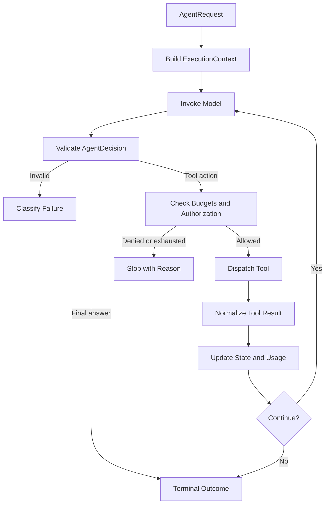
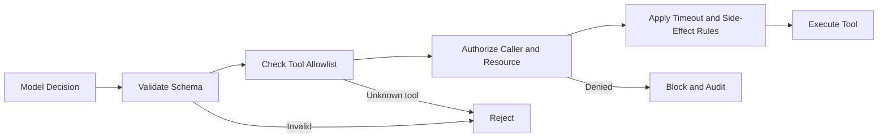

# 5.1 — Engineering Bounded Enterprise Agents: Execution Loops, Tool Budgets & Termination Control

## 1. An Agent Needs a Runtime, Not Just a Prompt

An AI agent can call a tool, inspect the result, and choose another action. That flexibility creates a runtime problem: what prevents it from repeating a step, consuming the request budget, or continuing after the caller has cancelled?

The answer is not a longer prompt. It is an execution boundary with explicit contracts, resource limits, validation, and terminal outcomes.

The central principle is: **the model proposes the next step; the runtime decides whether execution may continue.** This keeps control flow and safety policy in trusted application code rather than relying on the model to follow instructions perfectly.

## 2. Reference Architecture



The runtime coordinates six responsibilities: prepare context, invoke the model, validate its decision, check policy and budgets, execute permitted actions, and produce a predictable outcome. Each responsibility should be independently testable.

## 3. Define the Runtime Contracts

Keep the design framework-agnostic by separating four contracts:

- **`AgentRequest`** represents the caller's task, request ID, and trusted request context.
- **`AgentDecision`** represents a structured proposal: execute a named tool with arguments, or return a final answer.
- **`ExecutionContext`** tracks the current iteration, tool usage, token usage, deadline, cancellation state, and terminal reason.
- **`AgentRuntime`** owns the loop, enforces limits, validates decisions, dispatches tools, and decides when execution ends.

The model should not be allowed to populate trusted identity or permission fields. Those must come from the authenticated application context.

```python
from dataclasses import dataclass, field
from typing import Any, Literal

@dataclass(frozen=True)
class AgentRequest:
    request_id: str
    task: str

@dataclass(frozen=True)
class AgentDecision:
    kind: Literal["tool", "final"]
    tool_name: str | None = None
    arguments: dict[str, Any] = field(default_factory=dict)
    answer: str | None = None

@dataclass
class ExecutionContext:
    iterations: int = 0
    tool_calls: int = 0
    tokens_used: int = 0
    status: str = "running"
    stop_reason: str | None = None
```

These are compact contracts, not a complete runtime. A production context should also carry a deadline and cancellation signal. Parse model output into `AgentDecision` using strict schema validation before accepting it; type hints alone do not validate untrusted JSON at runtime.

## 4. Enforce Independent Execution Budgets

A single “maximum steps” setting cannot protect against every failure mode.

| Budget | What it controls | Where to enforce it |
|---|---|---|
| Iterations | Number of model decision cycles | Before each model call |
| Tool calls | Number of tool dispatch attempts | Before dispatch |
| Tokens | Model usage and cost | Before a call where possible, then reconcile reported usage |
| Elapsed time | Total request duration | Before each step and within model/tool clients |

A loop may make only a few model calls but use many tokens. Another may make many cheap tool calls. A deadline can expire while a network request is still running. These limits are complementary, not interchangeable.

```python
from dataclasses import dataclass

@dataclass(frozen=True)
class AgentLimits:
    max_iterations: int = 6
    max_tool_calls: int = 4
    max_tokens: int = 8_000
    timeout_seconds: float = 20.0

def budget_exhausted(ctx, limits, elapsed_seconds):
    if ctx.iterations >= limits.max_iterations:
        return "iteration_budget"
    if ctx.tool_calls >= limits.max_tool_calls:
        return "tool_budget"
    if ctx.tokens_used >= limits.max_tokens:
        return "token_budget"
    if elapsed_seconds >= limits.timeout_seconds:
        return "deadline_exceeded"
    return None
```

The values are examples, not universal defaults. Choose them from latency objectives, model cost, task complexity, and tool risk. Check the relevant budget at the point it protects: for example, check the tool-call budget immediately before dispatch, not only at the top of the loop.

Token accounting needs special care. Use provider-reported usage where available. If a response pushes usage over the limit, do not start another model call. A strict cost ceiling may also require limiting the requested output size because the final response itself can exceed the remaining budget.

## 5. Validate the Decision Before Executing It

A well-formed model response is not necessarily an allowed action. Treat every decision as untrusted input and apply a separate dispatch gate.



Before dispatch, the runtime should:

- Validate the decision type and required fields.
- Check the tool name against an explicit registry.
- Validate arguments against the selected tool's schema.
- Authorize the caller for the requested operation and resource.
- Apply a timeout and any required approval or idempotency controls.

Never execute an arbitrary function name supplied by the model. For high-impact actions such as payments, account changes, or deletion, require human approval when the risk policy calls for it. A timeout does not prove a side effect failed; reconcile the result or use idempotency keys before retrying.

## 6. Make Termination and Failure Outcomes Explicit

The runtime should own the decision to continue or stop. The model can return a final answer, but it cannot override a budget, cancellation request, or authorization denial.

Use stable terminal statuses such as:

- `completed` — the task returned a valid final answer.
- `blocked` — policy or a configured budget prevented further execution.
- `cancelled` — the caller or supervising service cancelled the request.
- `failed` — execution could not complete because of an unrecoverable error.

Pair the status with a machine-readable reason such as `model_final`, `tool_budget`, `unknown_tool`, `deadline_exceeded`, or `tool_timeout`. This makes outcomes easier to test, monitor, and explain.

Do not treat every error as retryable. Malformed model output, permission denial, transient provider failure, tool timeout, and budget exhaustion require different handling. Keep retries bounded and retry only classified transient failures. For tools with side effects, retry only when the operation is safe to repeat or can be reconciled.

## 7. A Compact Runtime Loop

The following pseudocode shows where the contracts and controls meet. Provider calls, strict validation, authorization, cancellation propagation, and tool adapters are deliberately represented as interfaces rather than hidden behind framework-specific code.

```python
def run_agent(request, model, tools, limits, clock, cancellation):
    ctx = ExecutionContext()
    history = []
    started = clock.monotonic()

    while ctx.status == "running":
        if cancellation.is_cancelled():
            ctx.status, ctx.stop_reason = "cancelled", "caller_cancelled"
            break

        elapsed = clock.monotonic() - started
        reason = budget_exhausted(ctx, limits, elapsed)
        if reason:
            ctx.status, ctx.stop_reason = "blocked", reason
            break

        try:
            raw_decision, usage = model.decide(
                request=request,
                history=history,
                timeout=limits.timeout_seconds - elapsed,
            )
            ctx.tokens_used += usage.total_tokens
            decision = validate_decision(raw_decision)
            ctx.iterations += 1
        except ModelTimeout:
            ctx.status, ctx.stop_reason = "failed", "model_timeout"
            break
        except InvalidDecision:
            ctx.status, ctx.stop_reason = "failed", "invalid_decision"
            break

        if ctx.tokens_used > limits.max_tokens:
            ctx.status, ctx.stop_reason = "blocked", "token_budget"
            break

        if decision.kind == "final":
            ctx.status, ctx.stop_reason = "completed", "model_final"
            return decision.answer, ctx

        reason = budget_exhausted(ctx, limits, clock.monotonic() - started)
        if reason:
            ctx.status, ctx.stop_reason = "blocked", reason
            break

        tool = tools.get(decision.tool_name)
        if tool is None:
            ctx.status, ctx.stop_reason = "blocked", "unknown_tool"
            break

        ctx.tool_calls += 1  # Count attempts, including failures.
        try:
            authorize(request, decision)
            result = tool.invoke(
                validate_arguments(tool, decision.arguments),
                timeout=remaining_time(started, limits, clock),
                cancellation=cancellation,
            )
            history.append(normalize_result(result))
        except AuthorizationDenied:
            ctx.status, ctx.stop_reason = "blocked", "authorization_denied"
        except ToolTimeout:
            ctx.status, ctx.stop_reason = "failed", "tool_timeout"
        except Exception:
            ctx.status, ctx.stop_reason = "failed", "tool_execution_error"

    return None, ctx
```

This is a design skeleton, not copy-and-run production code. `ModelTimeout`, `InvalidDecision`, `authorize`, `validate_arguments`, `remaining_time`, and result normalization are application interfaces. A complete implementation must also classify authorization and tool exceptions, ensure cancellation reaches in-flight clients, and guarantee that all exits produce a recorded terminal outcome. Keep cleanup and telemetry in a `finally` path so failures are observable too.

## 8. Deterministic Testing and Observability

Use fake model and tool implementations to test the runtime without relying on unpredictable live model responses.

| Test case | Expected behavior |
|---|---|
| Model returns a valid final answer | `completed / model_final` |
| Model repeatedly requests tools | Stops at the iteration or tool-call limit |
| Token budget is exhausted | No subsequent model call starts |
| Model returns malformed output | Rejected before tool dispatch |
| Model proposes an unknown tool | Blocked; no tool executes |
| Tool fails or times out | Classified outcome; bounded retry only if safe |
| Caller cancels or deadline expires | Stops and propagates cancellation |
| Side-effecting tool times out | Reconcile or retry idempotently |

Record request ID, iteration count, tool attempts, token usage, duration, terminal status, and stop reason. Avoid logging secrets, sensitive prompts, or full tool payloads by default. Useful observability answers two questions: **what did the agent do, and why did the runtime allow it to continue or stop?**

## 9. Backend Architecture Parallel

Traditional backend services validate input, authorize operations, enforce deadlines, classify failures, and return predictable outcomes. They do not let raw request input decide which operations are permitted.

An agent runtime needs the same discipline, with one additional concern: its next action is partly model-driven. The runtime therefore becomes the trusted boundary between probabilistic decisions and real system effects.

**Request → Decision → Validation → Policy and Budget Checks → Action → Result → Continue or Stop**

## Architecture Takeaways

- Treat the agent as a runtime subsystem, not just a prompt around a model call.
- Keep `AgentRuntime`, `AgentRequest`, `AgentDecision`, and `ExecutionContext` responsibilities explicit.
- Enforce iteration, tool-call, token, and elapsed-time budgets independently.
- Treat model output as a proposal; validate and authorize before dispatch.
- Use stable terminal statuses and machine-readable stop reasons.
- Test normal completion, budget exhaustion, cancellation, and model/tool failures independently.

## Further Reading

For deeper coverage across AI Engineering—from ML and Deep Learning to LLMs, RAG, Generative AI, and Agentic AI—explore the AI Engineering Handbook for concepts, engineering patterns, architecture, and production considerations.

[Enterprise AI Handbook](https://enterpriseai.handbook.mihirkjha.com/)

> **Enterprise AI Engineering Handbook**
>
> *Building Production-Grade Enterprise AI Systems — One Chapter at a Time.*
