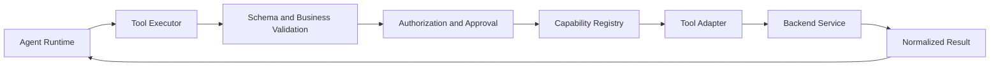
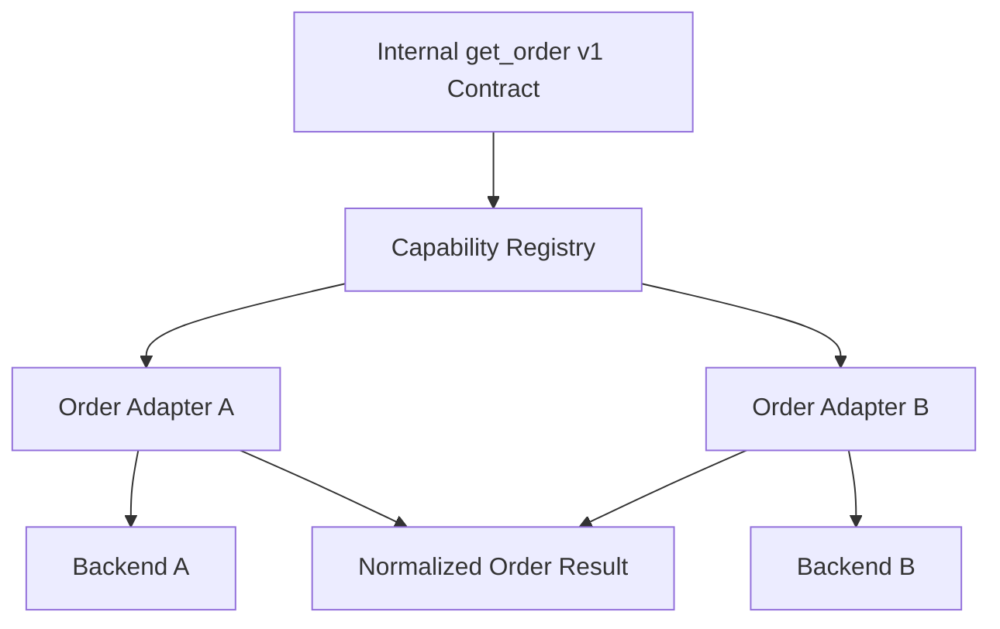

# 5.2 — Designing Typed Tool Contracts for Enterprise Agents: Capability Registries, Validation & Execution Boundaries

> **Series:** Enterprise AI Systems Architecture  
> **Phase:**  — AI Agents

When an enterprise agent needs to check an order, look up a customer, or create a support ticket, it needs a dependable way to request that capability.

Calling a backend SDK directly from the agent runtime may seem simple at first. But as tools grow, the runtime starts collecting backend-specific code, validation, authorization checks, timeout handling, and error mapping. Replacing one integration can then affect the agent itself.

The better approach is to make the tool boundary explicit: the agent requests a named capability, while trusted application code validates, authorizes, executes, and normalizes the result.

## 1. Start with the right boundary

A tool contract describes the capability and its expected inputs—not the SDK or API used to implement it. Keep discovery, validation, authorization, execution, and result normalization as distinct responsibilities.



The exact order of registry lookup and validation can vary. The invariant is that untrusted model output cannot invoke a backend directly, and authorization is checked before a protected action. Registration alone does not grant a caller permission to use a capability.

## 2. Define a typed, versioned tool contract

A specification should describe the tool’s name, version, input schema, timeout, and side-effect profile. It may also include approval requirements, idempotency support, and operational metadata.

```python
from dataclasses import dataclass
from typing import Any, Literal

@dataclass(frozen=True)
class ToolSpec:
    name: str
    version: str
    input_schema: dict[str, Any]
    timeout_seconds: float
    side_effect: Literal["read", "write", "destructive"]
    requires_approval: bool = False
```

Keep this metadata stable and provider-neutral. A `get_order` capability should have the same internal contract whether its adapter calls Service A or Service B.

Schema validation checks shape and type. Business validation checks whether values make sense for the requested operation. Authorization checks whether this caller may perform it. These are separate checks; passing one does not imply passing the others.

## 3. Resolve approved capabilities through a registry

The registry maps a capability and version to its specification and adapter. It should support controlled registration, lookup, version compatibility, and deprecation. Model output must never be allowed to register arbitrary tools or change their policy metadata.

```python
from typing import Protocol

class ToolAdapter(Protocol):
    def execute(
        self, arguments: dict, *, timeout_seconds: float
    ) -> dict:
        ...

class ToolRegistry:
    def __init__(self) -> None:
        self._entries: dict[
            tuple[str, str], tuple[ToolSpec, ToolAdapter]
        ] = {}

    def register(self, spec: ToolSpec, adapter: ToolAdapter) -> None:
        key = (spec.name, spec.version)
        if key in self._entries:
            raise ValueError(f"Duplicate tool registration: {key}")
        if spec.timeout_seconds <= 0:
            raise ValueError("Timeout must be positive")
        self._entries[key] = (spec, adapter)

    def resolve(self, name: str, version: str) -> tuple[ToolSpec, ToolAdapter]:
        try:
            return self._entries[(name, version)]
        except KeyError as exc:
            raise LookupError(f"Unknown capability: {name}@{version}") from exc
```

This is a compact in-process example, not a complete production registry. Production registration should be controlled and auditable. Capability availability can also depend on tenant, environment, and caller permissions, so resolution should not be confused with authorization.

## 4. Keep backend details inside adapters

Adapters translate the stable internal contract to the external API and normalize the response. Two different backends can implement one capability without teaching the agent runtime about both systems.



For example, one backend might return `orderStatus`, while another returns `state`. Each adapter maps its response into the same internal result shape. That lets the runtime depend on a stable contract rather than a vendor’s response format.

Keep retries and timeout behavior explicit. Retrying a read is often safe; retrying a write can duplicate a side effect unless the backend supports idempotency or the application can reconcile the outcome.

## 5. Put execution behind a trusted executor

The executor coordinates the stages and gives the runtime a consistent result. The following is illustrative application code: `validator`, `authorizer`, and `audit` are injected components, and the adapter must enforce the timeout at its transport or process boundary.

```python
from dataclasses import dataclass
from typing import Any

@dataclass(frozen=True)
class ToolResult:
    ok: bool
    data: dict[str, Any] | None = None
    error_code: str | None = None
    retryable: bool = False

def execute_tool(name, version, arguments, scope, registry,
                 validator, authorizer, audit):
    spec, adapter = registry.resolve(name, version)

    validator.validate(arguments, spec.input_schema)
    authorizer.require_allowed(
        scope=scope,
        capability=name,
        side_effect=spec.side_effect,
        requires_approval=spec.requires_approval,
    )

    audit.record_requested(scope, name, version)

    try:
        raw = adapter.execute(
            arguments, timeout_seconds=spec.timeout_seconds
        )
        return ToolResult(ok=True, data=normalize_result(name, raw))
    except TimeoutError:
        return ToolResult(
            ok=False, error_code="TOOL_TIMEOUT", retryable=True
        )
    except KnownBackendError as exc:
        return ToolResult(
            ok=False,
            error_code=map_backend_error(exc),
            retryable=is_transient(exc),
        )
```

`KnownBackendError`, `normalize_result`, `map_backend_error`, and `is_transient` represent application-specific functions or types. In a production implementation, also handle cancellation correctly, avoid leaking exception details to the model, and emit a correlation ID for protected diagnostics.

A structurally valid request can still be unauthorized. For write or destructive tools, policy may require approval, user confirmation, or an idempotency key. The model proposes the action; trusted code decides whether it may run.

## 6. Normalize results and failures

The runtime should not need to understand every backend’s exception classes or response envelopes. Use a small, stable set of result and error categories, such as:

- `INVALID_ARGUMENT`
- `CAPABILITY_NOT_FOUND`
- `AUTHORIZATION_DENIED`
- `APPROVAL_REQUIRED`
- `TOOL_TIMEOUT`
- `RATE_LIMITED`
- `BACKEND_UNAVAILABLE`
- `TOOL_EXECUTION_FAILED`

Return only what the agent needs to decide what to do next. Keep stack traces, credentials, internal URLs, and sensitive backend payloads in protected logs—not in model-visible errors.

Do not mark every failure retryable. Retryability depends on the error, operation type, and whether the system can determine if a side effect already happened.

## 7. Treat versioning and side effects as contract concerns

A read operation, an update, and a destructive action have different risk profiles. Encode that difference in trusted metadata and enforce policy at execution time.

For contract evolution:

- Prefer additive, backward-compatible changes.
- Introduce a new version for incompatible input or behavior changes.
- Test consumers and adapters against the same contract suite.
- Deprecate old versions deliberately instead of silently changing their meaning.
- Define timeout, retry, approval, and idempotency behavior for each side-effecting capability.

A timeout does not prove that the backend did not complete the operation. For a write, reconcile the result or retry with a supported idempotency key before repeating the action.

## 8. Test the boundary, not just the happy path

A useful test suite covers:

- Missing fields, wrong types, invalid values, and unexpected properties.
- Unknown capabilities, duplicate registration, and unsupported versions.
- Authorization denial, approval requirements, and tenant-specific access.
- Timeout, rate limit, backend outage, malformed responses, and cancellation.
- Consistent normalized results across at least two independent adapters.
- Retry behavior for writes, including duplicate-action prevention.
- Dependency direction: the agent runtime must not import provider-specific clients.

Run the same adapter contract tests against each implementation. This turns a backend replacement into a controlled integration change rather than a rewrite of the agent runtime.

## 9. Backend Architecture Parallel

This is the ports-and-adapters principle applied to agent tools. The runtime depends on stable capability contracts; adapters isolate external systems; and validation, authorization, observability, and error normalization sit at explicit boundaries.

The distinction is important: the model can propose a tool call, but it cannot grant itself access or decide that a risky action is safe.

## Architecture Takeaways

- Define typed, versioned capability contracts instead of embedding SDK calls in the runtime.
- Keep registry lookup, validation, authorization, execution, and normalization as explicit responsibilities.
- Treat registration and authorization as separate decisions.
- Make timeouts, side effects, retries, idempotency, and compatibility part of the contract.
- Test adapters against shared behavior and keep sensitive diagnostics out of model-visible errors.

**A dependable enterprise agent requests a capability through a stable contract. Trusted application code—not the model—controls how that request is validated, authorized, and executed.**

---


## Further Reading

For deeper coverage across AI Engineering—from ML and Deep Learning to LLMs, RAG, Generative AI, and Agentic AI—explore the AI Engineering Handbook for concepts, engineering patterns, architecture, and production considerations.

[Enterprise AI Handbook](https://enterpriseai.handbook.mihirkjha.com/)

> **Enterprise AI Engineering Handbook**
>
> *Building Production-Grade Enterprise AI Systems — One Chapter at a Time.*
---