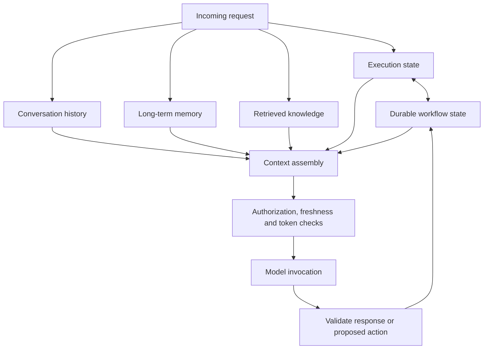
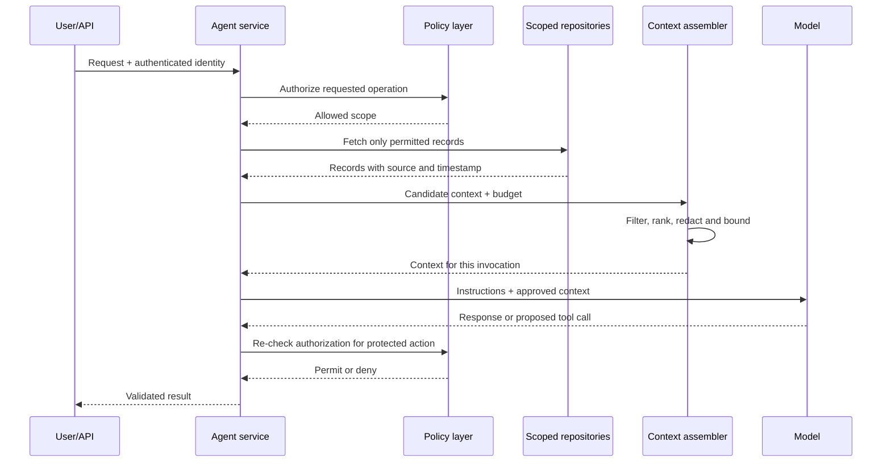
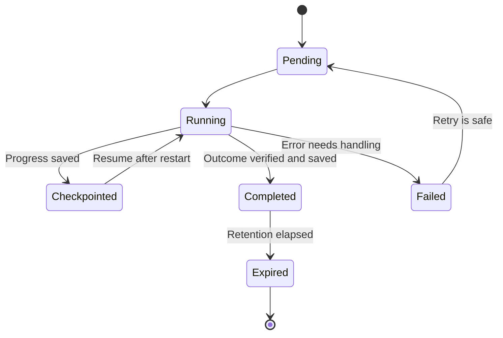

# 5.3 — Architecting Agent State for Enterprise Systems

> **Series:** Enterprise AI Systems Architecture  
> **Phase:**  — AI Agents

A customer asks: *“Can you check my order and tell me what happened to my last complaint?”*

The answer may need an order status, a complaint record, conversation history, and a remembered preference. These details do not belong in one store or carry the same level of trust.

Calling everything *memory* may work in a demo, but leaves production questions unanswered: Which record is authoritative? What survives a restart? What must be deleted? How do we prevent cross-tenant context leaks?

The practical approach is to give each kind of state a clear owner, then assemble a small, authorized context for each model invocation.

## 1. Separate state by purpose

| State category | What it answers | Typical owner | Expected lifetime |
|---|---|---|---|
| **Execution state** | What is happening in this invocation right now? | Agent service or short-lived execution store | One invocation |
| **Durable workflow state** | Which steps have completed, and where can work safely resume? | Workflow database or checkpoint store | Until completion and retention expiry |
| **Conversation history** | What has the user and agent said? | Conversation service | Product-defined retention period |
| **Long-term memory** | What useful, reusable information should carry into a later interaction? | Curated memory service | Until corrected, expired, or deleted |
| **Retrieved knowledge** | Which records or documents help answer this request? | Business systems and search indexes | Depends on source and index freshness |

These categories can share infrastructure, but they are not interchangeable. A checkpoint may record that the agent tried to create a support ticket; only the ticketing system can confirm that it exists. A vector index can locate a policy document, but it is not the source of truth for a payment or order.



The model receives only the context chosen for this task. The application remains responsible for authorization, persistence, and verification.

## 2. Build context deliberately

Context assembly is more than joining strings into a prompt. It is a policy-aware step that decides which information is relevant, allowed, fresh enough, and small enough to send.

A production flow should resolve tenant identity from trusted authentication, authorize before fetching, query the right source, retain provenance and freshness, exclude sensitive or expired data, rank within a token budget, and validate the model’s response or proposed action. Never use retrieval to determine whether a caller has permission.



### A small context-assembly boundary

This example shows the service boundary, not a complete policy engine. Each source adapter must enforce access rules; ranking and token counting need real implementations.

```python
from dataclasses import dataclass
from typing import Protocol


@dataclass(frozen=True)
class ContextItem:
    text: str
    source: str
    observed_at: str
    sensitivity: str = "internal"
    required: bool = False


@dataclass(frozen=True)
class ContextRequest:
    tenant_id: str       # resolved by trusted application code
    subject_id: str
    query: str
    max_tokens: int


class ContextSource(Protocol):
    def fetch(self, request: ContextRequest) -> list[ContextItem]:
        """Return only records authorized for this tenant and subject."""
        ...


class ContextRanker(Protocol):
    def rank(
        self, query: str, items: list[ContextItem]
    ) -> list[ContextItem]:
        """Rank using task relevance, freshness and source quality."""
        ...


class TokenCounter(Protocol):
    def count(self, text: str) -> int:
        ...


def assemble_context(
    request: ContextRequest,
    sources: list[ContextSource],
    ranker: ContextRanker,
    token_counter: TokenCounter,
) -> list[ContextItem]:
    candidates = [
        item
        for source in sources
        for item in source.fetch(request)
    ]

    # Required instructions/facts should be managed explicitly by policy.
    required = [item for item in candidates if item.required]
    optional = [item for item in candidates if not item.required]
    ranked_optional = ranker.rank(request.query, optional)

    selected: list[ContextItem] = []
    used = 0

    for item in required + ranked_optional:
        cost = token_counter.count(item.text)
        if used + cost <= request.max_tokens:
            selected.append(item)
            used += cost
        elif item.required:
            raise ValueError(
                "Required context exceeds budget; use a safe fallback"
            )

    return selected
```

Resolve `tenant_id` from trusted identity before calling this function. Only application policy—not retrieved content or model output—may mark an item as required. Reserve separate budget for instructions, the request, tool results, and the answer; `max_tokens` here limits context items only. If required context cannot fit, summarize it with provenance or narrow the task rather than silently dropping it.

## 3. Enforce tenant scope in the data layer

“Only use this customer’s data” in a prompt is not an access-control mechanism. Tenant isolation belongs in application services and repository queries, with database-level controls where available.

Avoid repository methods that retrieve a record by ID alone. A safer API makes the tenant and subject part of the lookup and gets those values from trusted application context.

```python
class TenantMemoryRepository:
    def __init__(self, db):
        self.db = db

    def get(self, *, tenant_id: str, subject_id: str, memory_id: str):
        return self.db.fetch_one(
            """
            SELECT memory_id, content, source, expires_at
            FROM agent_memory
            WHERE tenant_id = :tenant_id
              AND subject_id = :subject_id
              AND memory_id = :memory_id
              AND deleted_at IS NULL
              AND (expires_at IS NULL OR expires_at > CURRENT_TIMESTAMP)
            """,
            {
                "tenant_id": tenant_id,
                "subject_id": subject_id,
                "memory_id": memory_id,
            },
        )
```

Named parameters help prevent SQL injection; tenant, subject, deletion, and expiry filters enforce scope. Add database constraints and row-level security where available. Test guessed IDs, background jobs, tool calls, and cache reuse across tenants. Cache keys must include the correct scope.

## 4. Memory is useful—but it is not authority

Use long-term memory for reusable context, such as a preferred language or an ongoing-task summary. Because it can be stale or wrong, keep lifecycle metadata:

- **Provenance:** where the information came from.
- **Observed or confirmed time:** when it was last checked.
- **Expiry:** when it should no longer be used.
- **Scope and sensitivity:** which tenant or subject may use it.
- **Deletion status:** whether it has been withdrawn and must no longer be surfaced.

For consequential facts, consult the authoritative system. If memory says an order is pending, check the order service. If a retrieved document contains instructions, treat those instructions as untrusted content—not as system policy or permission to perform an action.

Vector retrieval is a relevance tool. Indexes can lag behind source changes, return similar-but-wrong chunks, and retain old embeddings after an update. For high-impact decisions, use retrieval to locate evidence, then verify the underlying record when possible. Memory and similarity scores must never become authorization signals.

## 5. Plan for deletion and recovery

Define the full lifecycle: expiry, deletion, and recovery after interruption.

- **Expiry:** apply TTLs or cleanup jobs to short-lived execution records and time-sensitive memories.
- **Deletion:** propagate removal to summaries, embeddings, caches, and other derived stores according to retention requirements. Make completion observable.
- **Cache invalidation:** use versioned keys, short TTLs, or invalidation events. Deleting the primary row does not remove a cached copy by itself.
- **Interrupted execution:** persist progress at meaningful boundaries and make side effects idempotent.
- **Partial failure:** when a workflow spans multiple systems, record the operation status and reconcile uncertain outcomes instead of assuming a timeout means the action failed.



A useful checkpoint records the current step, validated outputs, correlation ID, and idempotency key—not an indiscriminate dump of prompts, secrets, and tool payloads.

Suppose the agent calls a ticketing API and times out before receiving the response. On restart, it should not blindly create the ticket again. It should query the external system using an operation or idempotency identifier, determine whether the ticket already exists, and then continue from the verified state. A checkpoint records what the workflow believes happened; reconciliation checks what actually happened.

## 6. Test the failure paths

Test failure paths, not just the happy path:

- One tenant cannot read another tenant’s conversation, memory, workflow state, or cached result.
- Expired or deleted records never enter assembled context.
- A stale memory value is checked against the source of truth when correctness matters.
- Missing workflow state leads to a controlled recovery path, not an invented answer.
- A retry after a timeout does not duplicate a ticket, payment, or other side effect.
- Context assembly keeps required facts and instructions within a defined budget—or fails safely when it cannot.
- Deletion reaches derived stores and the system can report when propagation is complete.

Track context size and token use by source, freshness, cross-scope denials, expired items, cache invalidations, resume attempts, duplicate-action prevention, and deletion propagation time. Log identifiers and decisions—not sensitive prompts or full memory contents.

## 💼 Backend Architecture Parallel

This is familiar backend engineering, with a model at the edge:

- **Execution state** resembles request-local data.
- **Durable workflow state** resembles a persisted process manager or saga.
- **Conversation history** is an application-owned interaction log.
- **Long-term memory** is a curated profile or derived read model.
- **Retrieved knowledge** is a search projection over source systems.
- **Context assembly** is a policy-aware query and response-shaping layer.
- **The model** is a probabilistic component; it does not replace authorization, validation, or transaction boundaries.

The model’s context is a temporary working set—not the database of record.

## Architecture Takeaways

1. Give each kind of state a clear purpose, owner, and retention policy.
2. Authorize before retrieval; never use memory or vector similarity as permission.
3. Assemble the smallest useful, fresh, tenant-scoped context for each invocation.
4. Treat deletion, cache invalidation, and recovery as core design requirements.
5. Verify external side effects before retrying interrupted work.

**The rule of thumb:** store information according to its purpose, retrieve it according to the task, and authorize access before it reaches the model.


## Further Reading

For deeper coverage across AI Engineering—from ML and Deep Learning to LLMs, RAG, Generative AI, and Agentic AI—explore the AI Engineering Handbook for concepts, engineering patterns, architecture, and production considerations.

[Enterprise AI Handbook](https://enterpriseai.handbook.mihirkjha.com/)

> **Enterprise AI Engineering Handbook**
>
> *Building Production-Grade Enterprise AI Systems — One Chapter at a Time.*
---