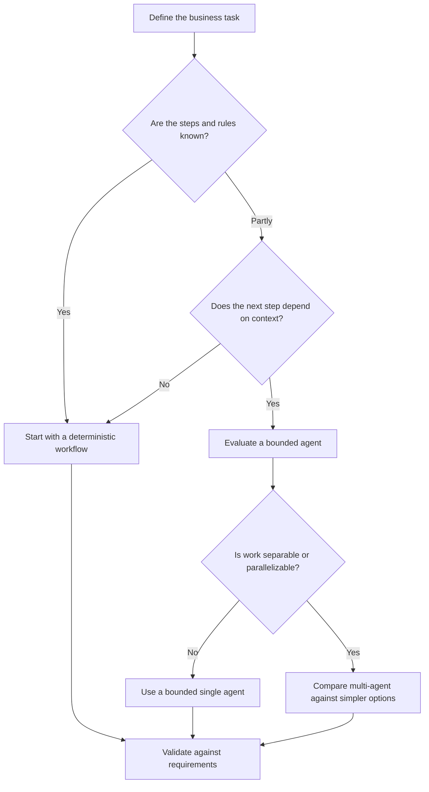
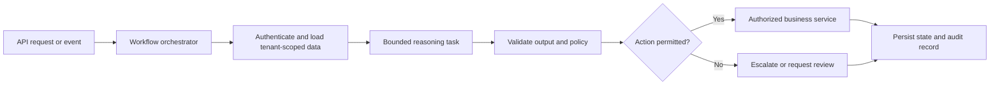

# 5.4 — Selecting the Right Enterprise AI Execution Model

A customer reports that an order arrived damaged. The support system needs to check the order, find the relevant policy, investigate the complaint, and prepare a response.

How much autonomy should we give the system?

We could define every step in a workflow. We could let one agent choose from a limited set of tools. Or we could split the investigation across several agents. Each option can work. The right choice depends on the task, its risks, and the operational complexity we are willing to own—not on which design sounds most advanced.

## 1. Choose the execution model based on the work

### Deterministic workflow

The application defines the sequence and owns each transition.

```text
Authenticate → Load order → Check policy → Validate outcome → Update case
```

This is usually the best starting point when the process and business rules are known. It is easier to test, audit, and recover because the application controls what happens next. An LLM can still handle a bounded task, such as summarizing a complaint or classifying its category, without controlling the entire process.

The limitation is flexibility: a fixed sequence can become awkward when the next step depends on information that cannot be known in advance.

### Bounded single agent

A bounded agent chooses its next step from a restricted set of approved tools. It might retrieve a policy first, notice that the order status is missing, and then request the order details.

This is useful when the path depends on context. But “bounded” must mean more than a prompt asking the model to behave. Enforce tool allowlists, permissions, call and iteration limits, timeouts, and stopping conditions in application code. The model can propose an action; trusted application code validates and executes it.

### Multi-agent system

Several agents divide the work—for example, one examines the complaint, another finds policy evidence, and a third drafts a response. This can help when responsibilities are genuinely separable or useful work can happen in parallel.

It also creates more moving parts: coordination, shared state, partial failures, cross-agent tracing, and recovery. More agents do not automatically mean better answers, lower latency, or lower cost. Measure those benefits for the actual workload.



This is a decision aid, not a rule that replaces workload testing.

## 2. Compare the trade-offs that affect production

| Dimension | Deterministic workflow | Bounded single agent | Multi-agent system |
|---|---|---|---|
| Control | Application owns transitions | Application sets limits; model selects steps | Coordinator and agents share execution |
| Flexibility | Best for known paths | Adapts within tool boundaries | Can divide work across roles |
| Coordination | Low | Moderate | Usually highest |
| Auditability | Direct step history | Requires model and tool-call traces | Requires linked traces across agents |
| Recovery | Resume from explicit workflow state | Recover tool and loop state safely | Recover partial agent results and coordination state |
| Side-effect control | Straightforward to centralize | Must guard tool execution and retries | Must guard every agent’s access and retries |
| Best fit | Stable process and strict rules | Context-dependent decisions | Measurable benefit from specialization or parallelism |

Use these questions when comparing candidates:

- **Predictability:** Must the same steps run in a controlled order?
- **Need for autonomy:** Does the task genuinely require the system to choose its next step?
- **Risk:** Could a retry create a duplicate ticket, refund, or other consequential action?
- **Latency and cost:** Does the design fit the service-level objective and budget?
- **Auditability:** Can an operator reconstruct which evidence and decisions led to the outcome?
- **Recovery:** Can the process resume after a timeout or restart without losing progress or repeating a side effect?

Do not treat these criteria as equally weighted by default. A payment or account-change workflow may require strict authorization and idempotency even if a more autonomous design appears faster. Define non-negotiable constraints first, then compare cost, latency, and flexibility among designs that meet them.

## 3. Consider a hybrid before adding more agents

The choice does not have to be “fixed workflow or autonomous agent.” A practical enterprise design often keeps business control deterministic and uses a model only where interpretation adds value.



For the support example, the workflow owns authentication, order retrieval, approval rules, retries, and the final case update. The model summarizes the complaint and recommends a next step. The application checks that recommendation before taking action.

Keep authorization, business rules, transaction boundaries, and idempotency outside the model’s authority. A model-generated recommendation is not permission to execute it.

## 4. Make the boundary visible in code

This small Python example shows the workflow controlling the sequence while a bounded reasoner returns a recommendation. The interfaces are deliberately simple; this is an architectural sketch, not a complete production service.

```python
from dataclasses import dataclass
from typing import Protocol


@dataclass(frozen=True)
class SupportRequest:
    tenant_id: str
    customer_id: str
    complaint_id: str


@dataclass(frozen=True)
class Investigation:
    order_status: str
    complaint_text: str
    policy_evidence: list[str]


@dataclass(frozen=True)
class Draft:
    summary: str
    recommended_action: str


class SupportData(Protocol):
    def load_investigation(
        self, request: SupportRequest
    ) -> Investigation: ...


class BoundedReasoner(Protocol):
    def draft_response(
        self, investigation: Investigation
    ) -> Draft: ...


class Policy(Protocol):
    def authorize(self, request: SupportRequest) -> None: ...
    def validate_recommendation(
        self, request: SupportRequest, draft: Draft
    ) -> None: ...


def handle_complaint(request, data, reasoner, policy) -> Draft:
    policy.authorize(request)
    investigation = data.load_investigation(request)
    draft = reasoner.draft_response(investigation)
    policy.validate_recommendation(request, draft)
    return draft
```

Two details matter here. First, the `SupportData` adapter must enforce tenant scope against trusted identity context; accepting a `tenant_id` argument is not enough by itself. Second, this function returns a draft. If the next step is to issue a refund or update a ticket, call a separate authorized service with idempotency controls and an audit record.

In a production implementation, also add typed error handling, timeouts, structured logs, tracing, persistence, and explicit handling for policy or model failures.

## 5. Compare implementations with evidence

Do not benchmark a workflow on one task and a multi-agent design on another. Run each candidate against the same representative scenarios and acceptance criteria. Track at least:

- **Correctness:** Did the result meet the same expected outcome?
- **Latency:** Measure end-to-end time, including model and tool calls.
- **Cost:** Include model usage and relevant tool or infrastructure costs.
- **Audit completeness:** Can the run be reconstructed from its records?
- **Recovery:** Does it resume safely after injected failures?
- **Duplicate side effects:** Can a retry repeat a consequential action?

Here is a small measurement wrapper. The candidate functions are intentionally injected: connect them to real implementations and test fixtures before treating the results as evidence.

```python
from dataclasses import dataclass
from statistics import median
from time import perf_counter
from typing import Callable


@dataclass
class RunResult:
    correct: bool
    cost: float
    audit_complete: bool
    recovered: bool
    duplicate_side_effect: bool


def measure(
    name: str,
    run_once: Callable[[], RunResult],
    repetitions: int = 5,
) -> dict:
    durations_ms = []
    outcomes = []

    for _ in range(repetitions):
        started = perf_counter()
        outcomes.append(run_once())
        durations_ms.append((perf_counter() - started) * 1000)

    return {
        "model": name,
        "runs": repetitions,
        "median_latency_ms": round(median(durations_ms), 2),
        "all_correct": all(r.correct for r in outcomes),
        "mean_cost": round(
            sum(r.cost for r in outcomes) / len(outcomes), 6
        ),
        "all_audits_complete": all(r.audit_complete for r in outcomes),
        "all_recovered": all(r.recovered for r in outcomes),
        "any_duplicate_side_effect": any(
            r.duplicate_side_effect for r in outcomes
        ),
    }


# Supply real implementations and a shared, controlled test scenario.
# results = [
#     measure("workflow", run_workflow),
#     measure("bounded_agent", run_bounded_agent),
#     measure("multi_agent", run_multi_agent),
# ]
```

This wrapper measures repeated runs, but it does not create a fair benchmark by itself. Your test fixture must define correctness, inject failures, capture costs consistently, and observe actual side effects. Include a normal request, missing policy evidence, a tool timeout, a restart after a completed step, and a retry of a side-effecting operation. Report the model versions, prompts, tool configuration, test data, and assumptions alongside the results.

Do not hide hard failures inside a single score. If duplicate refunds are unacceptable, treat that as a disqualifying result rather than allowing lower latency to compensate for it.

## 6. Record the decision in an ADR

An Architecture Decision Record (ADR) captures not only what the team selected, but why simpler or more complex alternatives were rejected.

```markdown
# ADR: Enterprise AI Execution Model

## Context
Describe the task, users, constraints, and risks.

## Decision drivers
List mandatory controls and the latency, cost, and quality targets.

## Decision
Name the chosen workflow, bounded agent, multi-agent, or hybrid design.

## Alternatives considered
Explain why each alternative does or does not meet the requirements.

## Evidence
Link benchmark results, acceptance tests, and operating assumptions.

## Revisit when
State what changes would justify another evaluation.
```

Avoid recording “multi-agent is too complex” as the only rationale. Note which requirement it failed, what evidence informed the decision, and what change might make the alternative worth revisiting.

## 💼 Backend Architecture Parallel

These are familiar backend design questions with model reasoning added at selected points:

- A deterministic workflow resembles explicit orchestration or a process manager.
- A bounded agent behaves like a decision component with a restricted tool interface.
- A multi-agent system introduces distributed coordination and partial-failure handling.
- Authorization, validation, idempotency, persistence, and audit records remain application responsibilities.

Planning and reflection are runtime capabilities, not separate execution topologies. They can be used inside a workflow or an agent design, but their presence alone does not justify adding more agents.

## Architecture Takeaways

1. Start with a deterministic workflow when the process and rules are known.
2. Add a bounded agent when context-dependent reasoning provides a clear benefit.
3. Choose multi-agent execution only when specialization or parallelism justifies the coordination cost.
4. Keep permissions, state transitions, side effects, and recovery under explicit application control.
5. Compare candidate designs against the same task, acceptance tests, and operating constraints.

**The goal is not maximum autonomy. It is the simplest execution model that meets the requirements for correctness, reliability, and operational control.**


## Further Reading

For deeper coverage across AI Engineering—from ML and Deep Learning to LLMs, RAG, Generative AI, and Agentic AI—explore the AI Engineering Handbook for concepts, engineering patterns, architecture, and production considerations.

[Enterprise AI Handbook](https://enterpriseai.handbook.mihirkjha.com/)

> **Enterprise AI Engineering Handbook**
>
> *Building Production-Grade Enterprise AI Systems — One Chapter at a Time.*