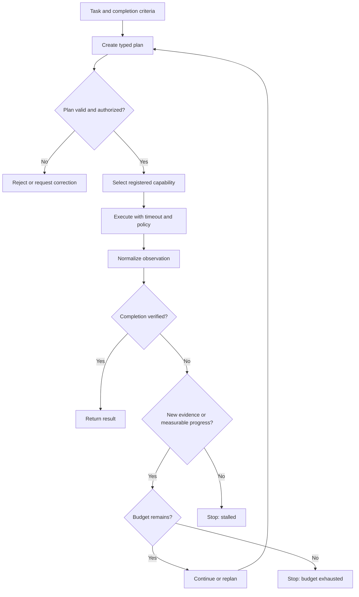
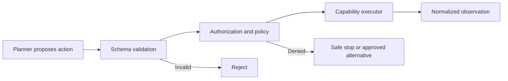

# Part 5.5 — Architecting Agent Planning and Reflection

An agent can look busy without getting any closer to finishing its task.

Imagine an agent retrieving an internal policy document. The search tool times out. The agent reflects, then retries the same request with the same inputs. It times out again. If the runtime cannot tell that nothing has changed, the agent may keep spending time and tokens without getting closer to an answer.

That is not just a prompt-design problem. It is a runtime design problem.

## 1. Where planning belongs in the architecture

Planning sits inside the agent execution model selected for the task. It should not become an alternative control plane that owns authorization, runtime limits, or durable business-process state.

A useful separation of responsibilities is:

- **Planner:** proposes a sequence of steps, dependencies, and expected outcomes.
- **Runtime controller:** validates the plan, tracks progress, and decides whether execution may continue.
- **Capability registry and executor:** expose approved operations and enforce input, authorization, timeout, and side-effect policies.
- **Observation normalizer:** converts tool responses and errors into a consistent contract.
- **Application or workflow layer:** owns business invariants, durable orchestration, checkpoints, and recovery when required.

### Bounded planning loop



Use planning when the task needs decomposition, dependencies, or adaptation. A simple lookup or deterministic business rule may be better served by a direct call or ordinary workflow. Choose the simplest model that meets the requirement.

## 2. Make the plan a typed contract

A generated paragraph is difficult to validate, compare, or execute safely. Represent a plan as structured data. Each step should identify a registered capability, its arguments, and the outcome that would count as progress.

```python
from dataclasses import dataclass
from typing import Any, Literal

@dataclass(frozen=True)
class Step:
    capability: str
    arguments: dict[str, Any]
    expected_outcome: str

@dataclass(frozen=True)
class Observation:
    status: Literal["ok", "retryable", "terminal"]
    state_changed: bool
    output: Any = None
    error_code: str | None = None
```

Before execution, validate that:

1. Every capability exists in the application-owned registry.
2. Arguments match the capability schema and size limits.
3. Dependencies and preconditions are satisfied.
4. The plan stays within allowed step count and depth.
5. Side-effecting actions meet authorization and approval requirements.

The model must not invent a tool name and have the runtime execute it as arbitrary code. The registry is the boundary between model intent and application capability.

Plan validation is not business validation: the owning service must still check business rules immediately before a side effect.

## 3. Select actions through a capability boundary

The planner can choose from registered capabilities, but it should not directly import provider SDKs or call arbitrary endpoints. A registry lets the application attach a schema, authorization requirements, timeout, retry classification, and side-effect policy to each operation.



A model-generated action is an untrusted request. Authorization must be checked at the point of action, not inferred from the fact that a tool was visible to the model.

For side-effecting capabilities, make retries explicit. If a request times out after the remote service has committed a change, the agent may not know whether the action happened. Idempotency keys, operation-status lookup, or reconciliation may be safer than blindly repeating the command.

## 4. Normalize observations before reflection

Different tools return different shapes: a document, an empty result, a timeout, a permission denial, or a partial response. The controller should not have to interpret every provider's unique response format.

Normalize results into a consistent observation that can include:

- Status: success, retryable failure, or terminal failure.
- Output or a reference to a larger result.
- Error category and retry guidance.
- Whether a meaningful state change occurred, if known.
- Latency, attempt number, and trace identifier.
- Side-effect status when the operation changes external state.

A timeout and a permission denial should not follow the same path. A timeout may be transient; a permission denial normally requires an authorized alternative or a safe stop. Error classification should be explicit rather than left entirely to free-form model interpretation.

## 5. Reflection should change a decision

Reflection is useful when evidence changes the next action. An empty search result might justify broadening the query. A terminal permission error might show that the task is blocked. A verified result might satisfy the application's completion criteria.

Reflection is unproductive when the action, inputs, and outcome repeat without new evidence or a state change.

A stable action signature can help identify repetition:

```python
import json

def action_signature(step: Step) -> tuple[str, str]:
    args = json.dumps(
        step.arguments,
        sort_keys=True,
        separators=(",", ":"),
        default=str,
    )
    return step.capability, args
```

Track signatures across a bounded recent history, along with the associated observations. When the same signature recurs, ask whether the previous outcome changed, whether external state could have changed, and whether the retry policy permits another attempt.

A repeated signature is a signal, not proof of a loop. Polling may repeat legitimately, so define an explicit policy with attempt limits, a deadline, and a meaningful completion check.

### Make the control decision explicit

```python
def decide(
    observation: Observation,
    repeated_without_progress: bool,
    budget_exhausted: bool,
    completion_verified: bool,
) -> str:
    if completion_verified:
        return "complete"
    if budget_exhausted:
        return "stop_budget"
    if observation.status == "terminal":
        return "stop_terminal_failure"
    if repeated_without_progress and not observation.state_changed:
        return "stop_stalled"
    if observation.status == "retryable":
        return "retry_or_replan"
    return "continue_or_replan"
```

The precedence between completion and budget exhaustion is an application decision. If a deadline has expired, the runtime may not be able to perform additional verification, even if the latest observation looks promising. Define these semantics explicitly and test them.

Most importantly, model confidence is not proof of correctness. Completion should be checked against application-owned criteria wherever possible.

## 6. Replanning needs a reason

Replanning should follow an identifiable event:

- A dependency failed and an approved alternative exists.
- A tool returned new information that changes the remaining work.
- The expected result was not found, but another permitted search strategy is available.
- A step is no longer necessary because its prerequisite evidence is already available.
- The current path is blocked and the task can be safely continued another way.

Record why each revision happened, which observation triggered it, and what changed. This makes traces useful during incident review.

Avoid replanning when the only new input is the model's restatement of the same failure. In that case, retry under an explicit policy, ask for human input, or stop.

## 7. Enforce budgets outside the model

Set hard limits for:

- **Iterations and plan revisions:** prevent endless planning cycles.
- **Tool calls:** total and per-capability ceilings.
- **Time:** task deadline and individual tool timeouts.
- **Tokens or cost:** model usage and a consistent cost proxy.
- **Retries:** error classification, attempt limits, and backoff.
- **Side effects:** authorization, approval, idempotency, and rate limits.

The runtime—not the model—must enforce these limits. Count planning and reflection costs too, and leave time to verify the outcome.

When a hard limit is reached, record the stop reason and terminate cleanly. A bounded failure with a clear explanation is better than an agent that continues making calls without progress.

## 8. Test the controller and evaluate the trade-off

Test runtime behavior deterministically before relying on end-to-end model evaluation. Cover valid and invalid plans, unknown capabilities, retryable and terminal failures, repeated actions without progress, completion criteria, unauthorized side effects, and each budget limit.

For example, using the `Step`, `Observation`, and `decide` definitions above:

```python
def test_repeated_failure_stops():
    obs = Observation(
        status="retryable",
        state_changed=False,
        error_code="TIMEOUT",
    )
    assert decide(
        obs,
        repeated_without_progress=True,
        budget_exhausted=False,
        completion_verified=False,
    ) == "stop_stalled"

def test_terminal_error_is_not_retried():
    obs = Observation(
        status="terminal",
        state_changed=False,
        error_code="FORBIDDEN",
    )
    assert decide(
        obs,
        repeated_without_progress=False,
        budget_exhausted=False,
        completion_verified=False,
    ) == "stop_terminal_failure"
```

These tests validate policy, not plan quality. Add separate decomposition/schema tests and integration tests for adapters, authorization, timeouts, and side effects.

To evaluate whether planning is worth the overhead, compare direct single-step execution with planning enabled on the same representative tasks and under equivalent limits. Track:

| Measure | Why it matters |
|---|---|
| Verified task success | Did the application confirm completion? |
| Tool calls and repeated-action rate | Did planning reduce wasted work? |
| End-to-end latency | What did planning add to response time? |
| Token usage or cost proxy | What did extra reasoning cost? |
| Stall and budget-stop rate | How often did the controller fail to make progress? |
| Recovery success | Did it handle transient failures safely? |

A direct call may be faster and just as reliable for simple tasks. Planning earns its place only when better success or recovery justifies its latency and cost.

## 💼 Backend Architecture Parallel

Think of the plan as a validated execution specification, the capability registry as an application-service boundary, the observation as a normalized result/error contract, and the budget manager as runtime policy.

Apply familiar backend principles: validate inputs, authorize at the action boundary, classify failures, expose state transitions, and define termination. Keep agent internals separate from durable workflow orchestration.

## Architecture Review Checklist

Before shipping a planning-enabled agent, ask:

- Can every proposed action be validated against a registered capability?
- Is authorization enforced immediately before protected actions?
- Are transient and terminal failures treated differently?
- Can the runtime detect repeated actions without misclassifying legitimate polling?
- Are completion criteria independent of the model's confidence?
- Are iteration, tool, time, and token/cost budgets enforced outside the model?
- Does every stop path produce a traceable reason?
- Have we measured planning against a simpler baseline on the same tasks?

## Architecture Takeaway

A reliable agent does not keep thinking until its budget runs out. It changes direction when the evidence supports a change, recognizes when it is stuck, and stops safely when it cannot make progress.

The design question I would bring to an architecture review is: **What observable condition allows this agent to continue—and what condition forces it to stop?**

---
## Further Reading

For deeper coverage across AI Engineering—from ML and Deep Learning to LLMs, RAG, Generative AI, and Agentic AI—explore the AI Engineering Handbook for concepts, engineering patterns, architecture, and production considerations.

[Enterprise AI Handbook](https://enterpriseai.handbook.mihirkjha.com/)

> **Enterprise AI Engineering Handbook**
>
> *Building Production-Grade Enterprise AI Systems — One Chapter at a Time.*
