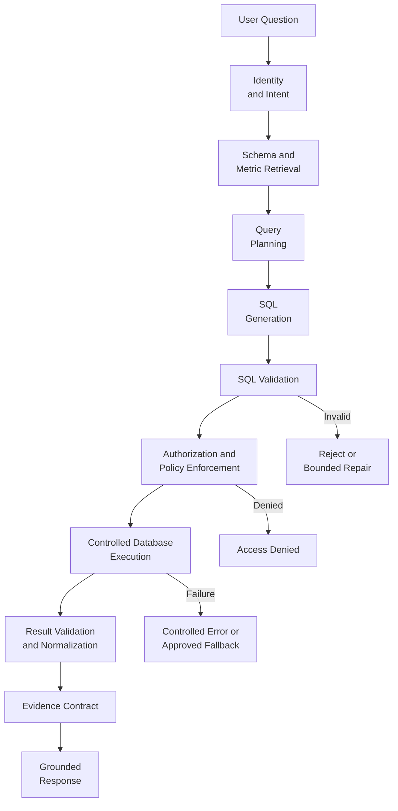
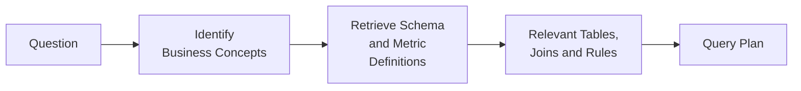
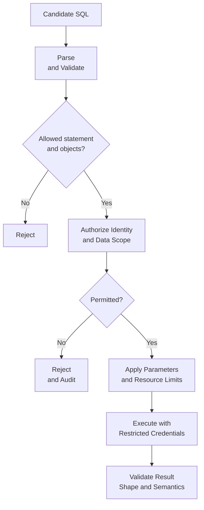
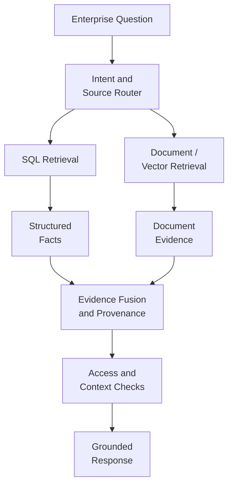

# 4.2 — Architecting SQL RAG for Structured Enterprise Knowledge

## 1. The Retrieval Problem Changes with Structured Data

Consider the question: *"What was the average transaction value for
German customers in Q2?"*

A vector search can find documents discussing German customers or
quarterly payments, but semantic similarity does not calculate an
average across transaction records. The answer depends on structured
data and a precise business definition.

SQL RAG connects natural-language questions to relational data. The
architecture must understand intent, retrieve relevant schema
information, construct a query, enforce access and execution policies,
validate the result, and present that result as evidence.

The key design principle is simple: **the LLM proposes; trusted
application components decide what may execute.** SQL RAG is not just
text-to-SQL. It is a controlled data-access system with an LLM at its
interpretation boundary.

## 2. Reference Architecture



Each component has a clear contract:

-   **Identity and intent** establishes who is asking and whether the
    task is a lookup, aggregation, comparison or explanation.
-   **Schema and metric retrieval** supplies relevant tables, columns,
    join paths, business definitions and approved measures.
-   **Query planning and generation** translate the intent into a
    candidate query.
-   **Validation and policy enforcement** check syntax, query shape,
    allowed data scope and user permissions.
-   **Execution** runs approved SQL through a restricted connection.
-   **Result validation** checks the output against the expected shape
    and business rules.
-   **Evidence and response** preserve what the database actually
    returned and explain it without inventing missing facts.

Keeping these responsibilities separate makes the system easier to test,
secure and observe.

## 3. Schema and Business Semantics Are Architecture Concerns

Schema awareness is more than adding table names to a prompt. Enterprise
schemas may contain ambiguous fields, legacy naming, complex joins and
metrics whose definitions differ across teams.

"German customers" could refer to registered country, residence or
business unit. "Q2" could be a calendar or fiscal quarter. "Transaction
value" could mean gross, net or settled amount. The model should not
silently choose among these interpretations when the choice changes the
answer.

A schema/semantic retrieval component should provide the minimum
relevant context:

-   Table and column descriptions, data types and relationships.
-   Approved join paths and reporting views.
-   Definitions of metrics such as "completed transaction" or "active
    customer."
-   Timezone, fiscal-calendar and currency rules.
-   Data classifications, permitted dimensions and access constraints.



For mature systems, keep business definitions in a governed semantic
layer or catalog rather than relying on prompt wording alone. Schema
retrieval narrows context; it does not prove that the generated query is
correct.

## 4. From Question to a Query Plan

Before generating SQL, turn the question into a structured plan. This
creates a place to resolve assumptions and validate intent independently
of SQL syntax.

For the example, a plan might specify:

-   **Measure:** average transaction amount.
-   **Population:** customers whose governed country attribute is
    Germany.
-   **Period:** Q2 for a confirmed year and calendar definition.
-   **Status:** only the business-approved set of eligible transactions.
-   **Currency:** one currency, or an approved conversion policy.
-   **Output:** one aggregate, with its period, filters and currency
    identified.

If the year, fiscal calendar or currency treatment is unclear, the
application should ask for clarification or apply an explicitly governed
default. Do not let a model-generated query conceal unresolved business
assumptions.

Assuming the reporting rules have been confirmed, a candidate SQL
statement could look like this:

```sql
SELECT AVG(t.amount) AS average_transaction_value
FROM transactions t
JOIN customers c ON c.customer_id = t.customer_id
WHERE c.country_code = :country_code
  AND t.transaction_date >= :start_date
  AND t.transaction_date < :end_date
  AND t.status = :status;
```

Bind values such as `:country_code` and `:start_date` as parameters; do
not interpolate user text into SQL. A half-open date range (start
inclusive, end exclusive) makes period boundaries easier to handle. The
example is not universally correct: averaging amounts across currencies,
or using the wrong status definition, can produce a plausible but
misleading result.

## 5. Validation, Authorization and Execution

Treat generated SQL as an untrusted proposal. A successful parse does
not prove that a query is safe, authorized or semantically correct.



A production validation layer should check that the statement is a
permitted query type, references approved tables or views, uses allowed
columns, and avoids prohibited operations. Use a SQL parser or AST-based
validator rather than brittle substring checks. Enforce timeouts, row
limits, query budgets and bounded retries.

Authorization is a separate decision. Use the authenticated identity and
trusted policy---not an LLM instruction---to enforce tenant boundaries,
row-level security, column masking and access to sensitive records.
Database permissions and approved reporting views provide defense in
depth. A read-only credential alone is insufficient: read queries can
still disclose sensitive data or consume excessive resources.

### A compact implementation skeleton

The following example illustrates the application boundary using
SQLAlchemy and `sqlglot`. The query planner is intentionally an
interface: connect it to your chosen model/provider, but require it to
return SQL plus parameter values. Install `sqlalchemy` and `sqlglot`,
configure a database URL securely, and adapt the allowlist and
authorization policy to the real schema.

```python
from dataclasses import dataclass
import sqlglot
from sqlglot import exp
from sqlalchemy import create_engine, text

@dataclass
class QueryPlan:
    sql: str
    params: dict
    expected_columns: set[str]

ALLOWED_TABLES = {"customers", "transactions"}

def validate_sql(sql: str) -> None:
    statements = sqlglot.parse(sql, read="postgres")
    if len(statements) != 1 or not isinstance(statements[0], exp.Select):
        raise ValueError("Only a single SELECT is allowed")

    tables = {t.name for t in statements[0].find_all(exp.Table)}
    if not tables or not tables.issubset(ALLOWED_TABLES):
        raise ValueError("Query references a non-approved table")

def execute_plan(engine, plan: QueryPlan, authorize):
    validate_sql(plan.sql)
    authorize()  # Must enforce the caller's trusted identity and scope.

    with engine.connect() as conn:
        result = conn.execute(text(plan.sql), plan.params)
        columns = set(result.keys())
        if not plan.expected_columns.issubset(columns):
            raise ValueError("Unexpected result schema")
        return [dict(row) for row in result.mappings().all()]

# Example only: engine credentials should come from secret management.
# engine = create_engine(DATABASE_URL, pool_pre_ping=True)
```

This is a teaching skeleton, not a complete security gateway. Production
code must validate table/column access and query cost more deeply,
enforce authorization in the database where possible, use statement
timeouts and restricted credentials, and test parser behavior for the
chosen SQL dialect. Parameterization protects values, not arbitrary SQL
structure. The model must never control credentials or bypass these
checks.

## 6. Normalize Results into Evidence

Do not pass raw database output to the LLM without an explicit contract.
Normalize the result into a stable structure containing the value and
enough provenance to explain how it was produced.

```python
evidence = {
    "source": "approved_transactions_view",
    "metric": "average_transaction_value",
    "filters": {
        "country_code": "DE",
        "period": "Q2",
        "status": "COMPLETED",
    },
    "result": {"value": 124.75, "currency": "EUR"},
    "execution_status": "success",
}
```

This is an illustrative shape; populate it from the actual approved
query and result. Include a currency only when the calculation's
currency policy supports it. Depending on the use case, provenance may
also include a query or report identifier, data timestamp, row count and
metric-definition version. Avoid logging sensitive rows or parameter
values unnecessarily.

The response model should explain the evidence, not recalculate it or
infer facts absent from it. Empty results, timeouts, ambiguous metrics
and validation failures need explicit outcomes. If execution failed, do
not generate a confident answer from the question alone.

## 7. SQL RAG and Vector RAG Work Together

SQL is suited to filtering, counting, aggregation and calculations over
structured records. Vector/document retrieval is suited to policies,
procedures, incident reports and other evidence expressed in language. A
source router can select one or both paths.



For example, SQL might show that payment failures increased by 18%
during a defined period. Incident reports may describe possible causes.
The architecture must distinguish the measured trend from the
explanatory evidence; correlation in the data does not automatically
prove a cause.

| Question | Likely retrieval path | 
|---|---|
 | What does the tokenization policyrequire?| Document retrieval|                         
 | How many completed transactions  occurred yesterday? | SQL|
 | Why did failures increase last week?| SQL plus incident documents|
 | Which control governs a process,    Documents, metadata and possibly
  and who owns it?| Graph retrieval|
  -----------------------------------------------------------------------

The router should be evaluated on source selection as well as final
answer quality.

## 8. Failure Modes, Observability and Evaluation

Common failures include selecting the wrong table or join,
misinterpreting a business metric, using incorrect date boundaries,
mixing currencies, producing an expensive query, exceeding permissions,
or narrating results beyond the evidence. Mitigations belong at
different layers: semantic definitions for metric ambiguity, schema
retrieval for table selection, SQL validation for query shape,
authorization for access, resource controls for cost, and response
constraints for unsupported claims.

Evaluate the full path---not only whether SQL executes. Maintain test
cases with expected interpretations and trusted outcomes, including
ambiguous questions, empty results, unauthorized requests, edge dates,
null values, currency cases and malicious input.

Track:

-   Query generation, validation and execution success.
-   Correctness against trusted reference results.
-   Schema and metric-selection errors.
-   Authorization denials and policy violations.
-   Latency, timeouts, query cost and repair attempts.
-   Empty results, fallback frequency and response-grounding errors.

Logs should support investigation while minimizing exposure of sensitive
prompts, parameters and result rows. Observability should answer both
"Did the query run?" and "Did it answer the intended question under the
correct permissions?"

## 9. Backend Architecture Parallel

Traditional backend systems validate requests, authenticate callers,
authorize operations, execute controlled business logic and validate
responses. They do not let raw request input decide which database
operations are permitted.

SQL RAG should follow the same discipline. The model proposes a query;
trusted application components validate, authorize and execute it. The
database result becomes evidence for the response.

**Request → Validation → Authorization → Execution → Result Validation →
Response**

## Architecture Takeaways

-   SQL RAG extends retrieval into structured, authoritative enterprise
    data.
-   Schema and business semantics matter as much as SQL syntax.
-   Query generation, validation, authorization and execution are
    separate architectural responsibilities.
-   Results need provenance and a stable evidence contract before
    generation.
-   SQL and document retrieval are complementary paths that can be
    orchestrated together.
-   Security, correctness, observability, latency and cost must be
    designed as one system.

The goal is not unrestricted database access for an LLM. It is
controlled, auditable access to structured knowledge through a retrieval
architecture.

## Further Reading

For deeper coverage across AI Engineering — from ML and Deep Learning to LLMs, RAG, Generative AI, and Agentic AI — explore the AI Engineering Handbook for concepts, engineering patterns, architecture, and production considerations.

[Enterprise AI Handbook](https://enterpriseai.handbook.mihirkjha.com/)
