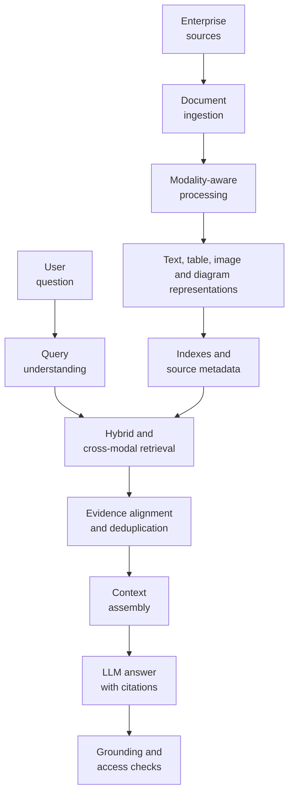
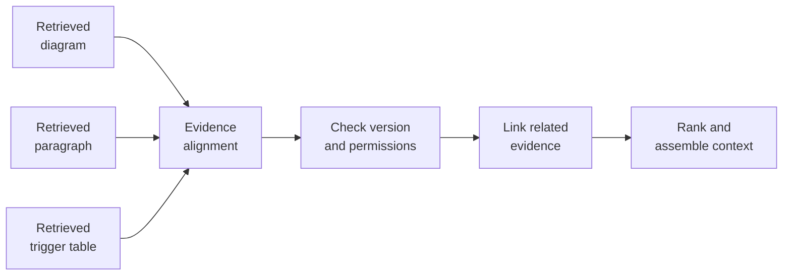

# 4.3 — Designing Multimodal RAG for Enterprise Knowledge

## 1. Why text-only RAG reaches a limit

A common enterprise RAG pipeline starts with documents, extracts text, splits it into chunks, creates embeddings, and retrieves the most relevant chunks for a user question. That pattern works well when the answer is expressed clearly in paragraphs. It becomes less reliable when the important evidence lives in a diagram, a table, a screenshot, or the relationship between a visual and its accompanying explanation.

Imagine an engineer asks:

> How does the payment platform route a transaction through fraud detection, and which conditions trigger the check?

The answer may be spread across three places:

- An architecture diagram shows the payment service calling a fraud-detection service.
- A paragraph explains that the call happens before authorization for selected transaction types.
- A table lists the risk thresholds or transaction conditions that trigger the check.

Extracting only paragraph text can miss the arrows in the diagram. OCR may capture labels but not reliably reconstruct the flow. A table flattened into a string can lose the meaning of rows and columns. Retrieving any one source in isolation may therefore produce a plausible but incomplete answer.

**Multimodal RAG** extends retrieval to evidence represented in more than one modality. The goal is not simply to attach image embeddings to a vector database. It is to retrieve relevant evidence, preserve how that evidence relates to the source document, and assemble enough context for a grounded answer.

## 2. A practical architecture

A useful design separates ingestion, retrieval, evidence alignment, and answer generation. 



Separate **retrieval representations** from **source evidence**. An embedding helps locate a candidate; it does not prove what the source says. Retain a path to the original page, image region, table, or paragraph.

## 3. Ingestion: create useful representations, not just chunks

Multimodal ingestion needs modality-aware steps, not one universal parser.

**Text.** Extract paragraphs, headings, captions, and reading order. Chunk by meaningful sections where possible, and preserve document ID, page number, heading path, version, and access-control metadata.

**Tables.** Preserve rows and columns instead of treating the entire table as an unstructured sentence. Depending on the use case, store a normalized representation, a compact textual rendering, or both. Keep the table title, column names, row identifiers, and source location.

**Images and diagrams.** OCR can capture visible labels. Vision-language models can produce descriptions or answer targeted questions about a figure. For architecture diagrams, the representation should capture entities and connections—such as “Payment API calls Fraud Service”—rather than only a generic caption like “a system architecture diagram.”

**Scanned documents and screenshots.** Use OCR or document-understanding services when the content is not available as machine-readable text. Keep extraction confidence where available, so low-confidence content can be reviewed or handled cautiously.

A practical representation record might look like this:

```python
evidence = {
    "document_id": "payments-architecture-v3",
    "version": "3",
    "page": 12,
    "evidence_id": "fig-12-1",
    "modality": "diagram",
    "text": "Payment API calls Fraud Service before authorization",
    "source_uri": "s3://knowledge/payments-v3.pdf#page=12",
    "access_scope": ["payments-engineering"],
}
```

This is illustrative, framework-agnostic code. Validate source locations and permissions in the ingestion pipeline; never trust user-supplied values or generated captions for authorization.

## 4. Retrieval: combine signals without losing source identity


A **shared embedding space** can make cross-modal retrieval simpler when the chosen embedding model supports the required modalities. Separate text, image, and table indexes can give more control over modality-specific processing and ranking. A hybrid design is often practical: use lexical search for exact identifiers and error codes, vector search for semantic similarity, and modality-specific retrieval for visual or structured evidence.

The query should guide retrieval. A question about a diagram may require the figure, its explanatory paragraph, and a table of conditions—not just text mentioning the same service name.

```python
def answer_multimodal_question(question, user, services):
    # Derive permissions from the authenticated identity.
    filters = services.policy.allowed_document_filters(user)

    # Each adapter returns evidence with source, version, modality,
    # location, score and access metadata.
    candidates = []
    for name in ("lexical", "text_vector", "visual", "table"):
        retriever = services.retrievers.get(name)
        if retriever is not None:
            candidates.extend(
                retriever.search(question, filters=filters, limit=8)
            )

    candidates = services.policy.recheck(candidates, user)
    aligned = services.evidence.align_and_rank(candidates)
    context = services.context.build(
        question=question,
        evidence=aligned,
        token_budget=services.config.context_token_budget,
    )

    answer = services.llm.generate(
        question=question,
        context=context,
        require_citations=True,
        abstain_without_support=True,
    )
    return services.citations.validate(answer, aligned)
```

This is an adapter-based orchestration skeleton, not a drop-in runnable app: `services` must be wired to your chosen parsers, indexes, policy engine and model. It makes the critical control points explicit—trusted authorization, retrieval, evidence alignment, bounded context, grounded generation and citation validation.
Metadata filters matter as much as similarity. Tenant, business unit, document classification, version, and user permissions should constrain candidate retrieval before evidence reaches the model. A highly relevant but unauthorized diagram must never be included in the prompt.

## 5. Evidence alignment: the part that is easy to overlook

Independent retrieval results can be individually relevant but collectively confusing. A diagram may come from version 3 while a paragraph comes from version 2. A table may describe a retired fraud rule. A caption may refer to a neighbouring figure rather than the one retrieved.

Evidence alignment resolves these problems before context assembly. Each item should carry source identity, version, page or region, modality, and validated relationships so related items can be grouped correctly.



For example, the diagram's service label can be linked to a paragraph that explains the call sequence and a table that defines trigger conditions. Those links should be grounded in source structure, extracted relationships, or validated metadata—not invented merely because two chunks have similar embeddings.

Deduplication should also respect provenance. Two nearly identical chunks from different policy versions are not necessarily duplicates; the version difference may be the most important fact. Preserve both only when the question requires comparison, otherwise prefer the authorized current version.

## 6. Context assembly and grounded answers

After alignment, the system must choose what to send to the model. Sending every result wastes tokens; sending only the top chunk may remove context needed to interpret it.

A context assembler should select a compact set that covers the question, preserves relationships, and includes source references: the diagram for flow, the paragraph for sequencing, and the table for trigger conditions.

A useful answer contract is:

1. State the conclusion supported by the evidence.
2. Explain which sources support each part.
3. Cite document version and page, table, or figure where available.
4. Say when evidence is missing, ambiguous, or contradictory.

For the payment example, a grounded answer might explain that the diagram shows the Payment API calling Fraud Service before authorization, while the accompanying rule table defines the conditions that trigger the check. It should cite the actual diagram and table. It should not invent a threshold if the retrieved source does not contain one.

The model should receive extracted content and source references together. The application—not the model alone—should control citation formatting and verify that each citation points to a retrieved, authorized source.

## 7. Production trade-offs and evaluation

Two common processing choices have different costs.

| Design choice | Benefit | Cost or risk |
|---|---|---|
| Analyse visuals during ingestion | Faster query-time retrieval; representations can be reused | Higher upfront processing cost; reprocessing when models or documents change |
| Analyse visuals at query time | Can focus on the specific question; less work on unused images | Higher latency and runtime cost; variable results |
| Shared index | Simpler cross-modal candidate search | Depends on model compatibility and ranking calibration |
| Separate indexes | Modality-specific tuning and observability | More orchestration, score normalization, and deduplication |
| Store generated captions only | Lower storage and simpler retrieval | Captions can omit layout, relationships, or details needed later |

A hybrid approach often works well: process common content during ingestion, then apply expensive visual analysis to a small shortlist at query time.

Evaluate more than answer fluency. Useful measures include:

- **Retrieval recall:** Did the system find the necessary diagram, table, and text?
- **Evidence completeness:** Were all parts of the question supported?
- **Groundedness:** Does each claim follow from cited evidence?
- **Citation accuracy:** Do references point to the correct page, figure, and version?
- **Access-control correctness:** Were unauthorized items excluded?
- **Operational cost:** What are the ingestion cost, query latency, storage footprint, and reprocessing burden?

Build a test set that genuinely requires multiple modalities. Include outdated diagrams, ambiguous labels, scanned tables, conflicting versions, missing evidence, and users without access. Measure whether the system abstains when it cannot support a reliable answer.

## 8. End-to-end implementation pattern

For the payment-platform question, a production request can follow this sequence:

1. Authenticate the user and derive trusted access filters.
2. Parse the question into required evidence types: flow, explanation, and trigger conditions.
3. Retrieve candidate diagrams, text passages, and tables in parallel.
4. Apply authorization and version checks, then deduplicate and link related evidence.
5. Assemble a compact context with source references.
6. Generate an answer constrained to that evidence.
7. Validate citations and log retrieval results, latency, and grounding signals.

Keep each stage observable. Engineers need to distinguish retrieval misses, parsing errors, version mismatches, poor context assembly, and unsupported generation. Without stage-level telemetry, “the model got it wrong” is too vague to fix.

## Conclusion

Multimodal RAG is not simply text RAG with images added to a vector database. It is an evidence-management problem across different representations. Enterprise reliability depends on choosing appropriate processing for each modality, retrieving complementary sources, preserving provenance and relationships, enforcing access controls, and evaluating whether the assembled evidence actually supports the answer.

The architectural goal is straightforward: **retrieve the right evidence, keep it connected to its source and context, and make every important claim verifiable.**

---

## Further Reading

For deeper coverage across AI Engineering — from ML and Deep Learning to LLMs, RAG, Generative AI, and Agentic AI — explore the AI Engineering Handbook for concepts, engineering patterns, architecture, and production considerations.

[Enterprise AI Handbook](https://enterpriseai.handbook.mihirkjha.com/)


> **Enterprise AI Engineering Handbook**
>
> *Building Production-Grade Enterprise AI Systems — One Chapter at a Time.*
