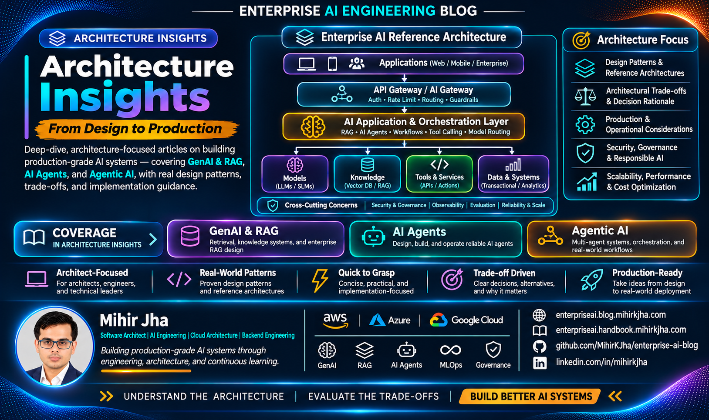
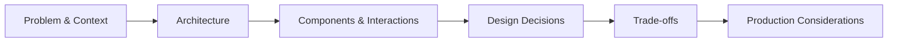
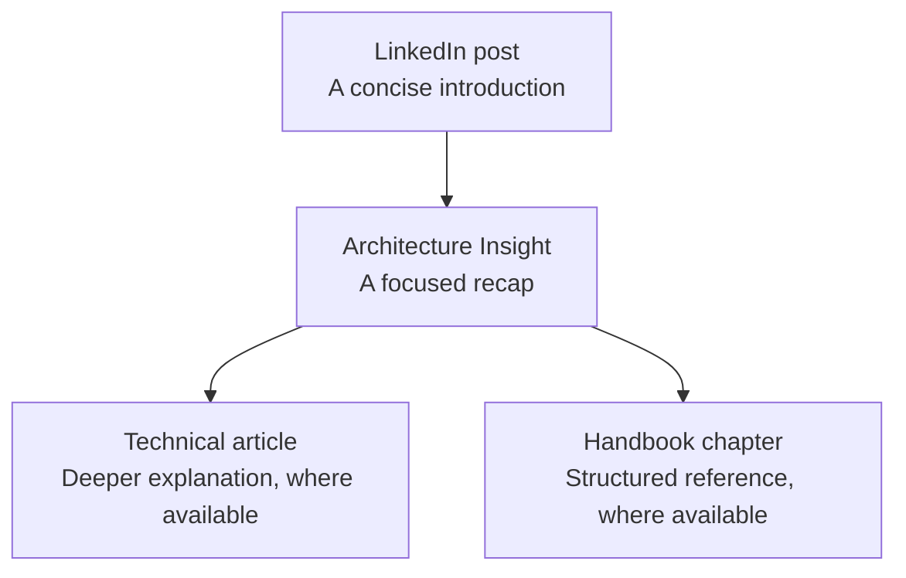

# 🏗️ Architecture Insights

**Understand the architecture. Evaluate the trade-offs. Build better AI systems.**

Enterprise AI architecture involves much more than choosing an LLM or connecting a vector database. It means deciding how models, data, retrieval, agents, tools, security, and infrastructure should work together — and understanding the consequences of those decisions.

**Architecture Insights** is where I explore those decisions through short, practical articles connected to my **Enterprise AI Systems Architecture** series on LinkedIn.

The idea is simple: take one architectural topic, explain the problem it addresses, show how the main pieces fit together, and highlight the decisions and trade-offs that matter when the system moves towards production. These are quick recaps, not replacements for detailed technical articles or handbook chapters.

## Explore Architecture Insights

The collection is organized around three areas. They overlap in real-world systems, but each gives us a useful way to look at a different part of enterprise AI engineering.

-   **🧠 Gen AI & RAG**

    ---

    How do we connect foundation models to enterprise knowledge?

    Explore retrieval pipelines, embeddings, vector search, reranking, grounding, and the architecture of knowledge-aware applications.

-   **🤖 AI Agents**

    ---

    How do we build agents that can do more than generate a response?

    Explore agent design, tool integration, memory, execution, orchestration, and the controls needed to make agents dependable.

-   **🔗 Agentic AI**

    ---

    What changes when multiple agents and workflows work together?

    Explore multi-agent systems, coordination, communication, delegation, and the design of more complex AI-driven processes.

Use the Architecture Insights navigation menu to browse the topics within each area.

## What to expect from an insight

I want each insight to answer the questions an engineer or architect is likely to ask: What problem are we solving? Which components are involved? How do they interact? Why choose one design over another? What should we consider before taking it to production?

Depending on the topic, an insight may include:

- The problem and the architectural context
- The main components and their responsibilities
- Request, data, and control flows
- Design patterns and alternative approaches
- Trade-offs involving complexity, reliability, security, scalability, and cost
- Practical implementation and operational considerations

Some topics need a diagram; others need a comparison or a closer look at a design decision. The format can change, but the focus stays on making the architecture easier to understand.

## From LinkedIn to a deeper reference

Each insight is connected to a topic in the **Enterprise AI Systems Architecture** series on LinkedIn. The LinkedIn post introduces the idea and encourages discussion; the blog recap gives readers a place to revisit the architecture with additional context.

When a topic has a related technical article or handbook chapter, those resources can take the discussion further. Not every insight will have a separate long-form article or chapter, and I’ll link related material where it exists.

## What makes these insights useful

The goal is not to list technologies or repeat product documentation. It is to make the reasoning behind a design visible.

- **Architecture first:** Start with the problem and system boundaries.
- **Real design choices:** Explain why components are used and how they fit together.
- **Trade-offs included:** Consider alternatives, constraints, and consequences.
- **Production in mind:** Look beyond the happy path to security, reliability, observability, and operations.

## Keep exploring

Architecture Insights is part of a wider collection of technical writing and engineering work. Each resource has a different role, so you can choose the level of detail that suits what you're working on.

| Resource | What you'll find |
|---|---|
| **Technical articles** | Longer explanations, implementation details, and deeper analysis where available |
| **LinkedIn** | Short-form architecture insights, discussion, and announcements |
| **Newsletter** | Selected updates from the wider Enterprise AI Engineering journey |
| **Handbook** | Structured, chapter-based technical reference material |
| **GitHub** | Projects, experiments, and supporting source code |

## 📚 Enterprise AI Engineering Handbook

The **Enterprise AI Engineering Handbook** brings related topics together in a structured, chapter-based format. It is the place to go when you want to study a subject in more depth or return to a consolidated technical reference.

[Explore the Enterprise AI Engineering Handbook](https://enterpriseai.handbook.mihirkjha.com/)

## 💻 GitHub

I share implementation projects, experiments, and supporting engineering work on GitHub.

[Explore my GitHub projects](https://github.com/MihirKJha/)

## 💼 LinkedIn

Follow the **Enterprise AI Systems Architecture** series for new insights, architecture discussions, and conversations about designing production AI systems.

[Connect with me on LinkedIn](https://www.linkedin.com/in/mihirkrjha/)

## 📰 Enterprise AI Engineering Newsletter

The **Enterprise AI Engineering** newsletter brings together selected perspectives on AI engineering, cloud architecture, backend systems, and production AI.

[Read the Enterprise AI Engineering Newsletter](https://www.linkedin.com/newsletters/enterprise-ai-engineering-7479222208079319041/)

## 👨‍💻 About the Author

**Mihir Jha**  
*Software Architect | AI Engineering | Cloud Architecture | Backend Engineering*

I write about the engineering decisions involved in building intelligent systems. My interests sit at the intersection of backend engineering, cloud-native architecture, and modern AI — especially the work needed to make systems scalable, secure, observable, and practical to operate.

---

### Better Architecture. Smarter Systems. Real Production Impact.

**Architecture Insights · Enterprise AI Systems Architecture**

© 2026 Mihir Jha

