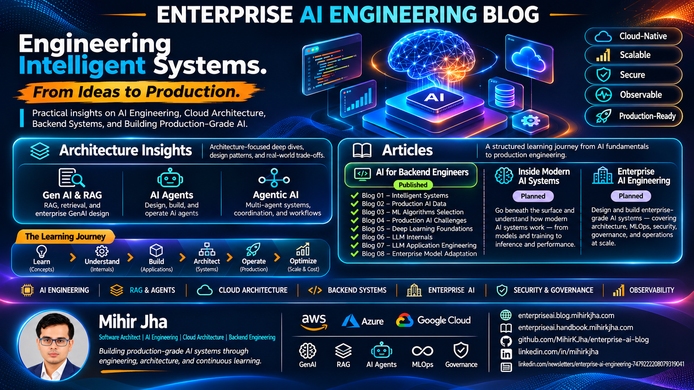
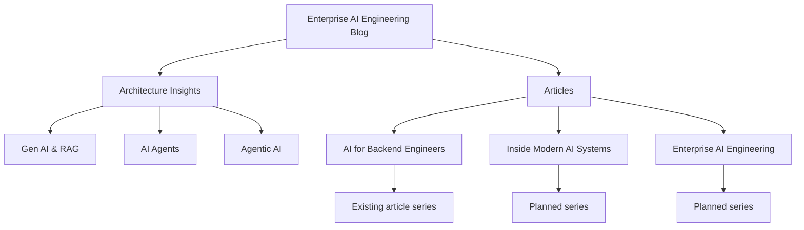
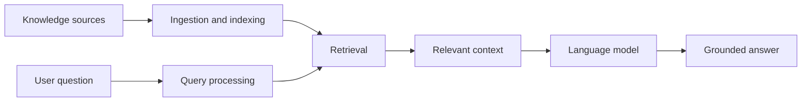
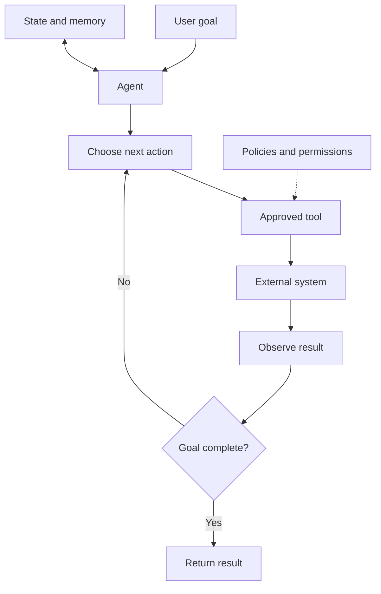
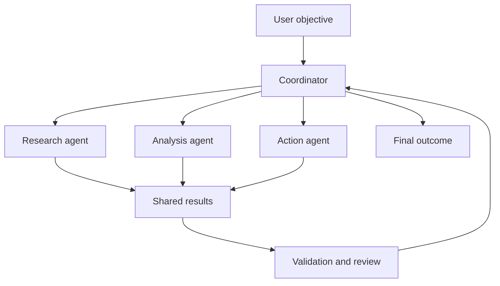
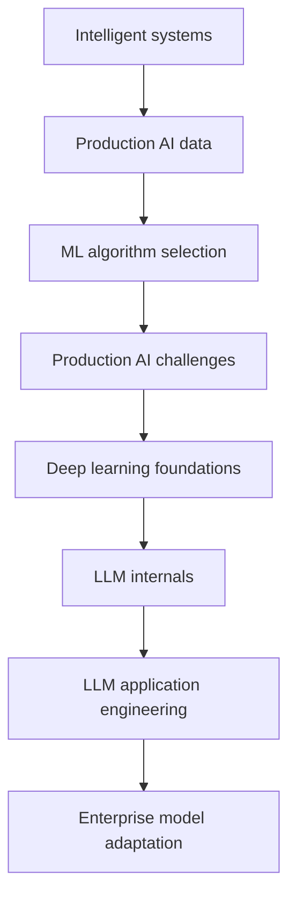
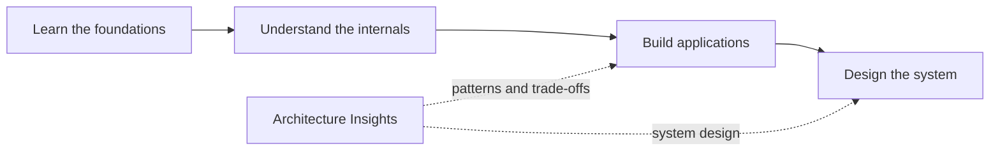
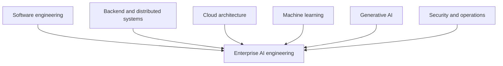
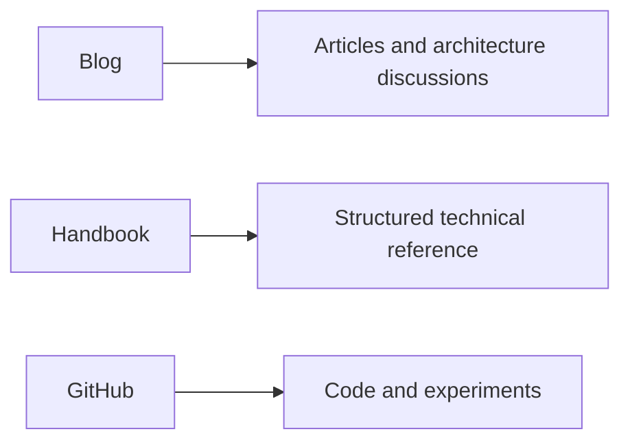
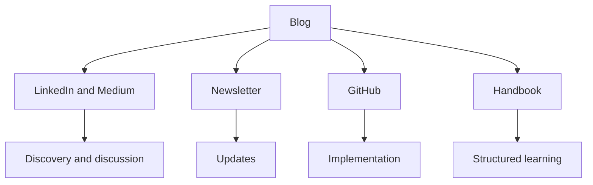

# Enterprise AI Engineering Blog

  

> **Understanding the technology is one thing. Knowing how to build with it is another.**

Welcome. I’m Mihir Jha, a software architect with a background in backend engineering, distributed systems, and cloud architecture. This blog is where I explore how those disciplines connect with modern AI.

AI is moving quickly, but building a useful AI application still involves familiar engineering questions. Where does the data come from? How does the application interact with a model? What happens when retrieval fails, a tool call times out, or the model returns an unreliable answer? How do we secure, monitor, and operate the whole system once people depend on it?

Those are the kinds of questions I want to explore here. Some posts explain the foundations; others look inside the technology; and the architecture insights focus on how the pieces fit together in real systems.

The blog is organized into two areas: **Architecture Insights** and **Articles**.

---

# 🧭 Explore the Blog

## 🏗️ Architecture Insights

Architecture Insights is for the questions that come up when you move beyond a demo and start thinking about the system around an AI model.

A diagram can show the components, but the interesting part is often the reasoning behind them: why a retrieval layer is needed, where an agent should be allowed to use a tool, how services should communicate, and what trade-offs appear when a design has to scale.

This section brings together three areas:

### Gen AI & RAG

Generative AI applications often need more than a prompt and a model endpoint. They may need to connect to enterprise data, retrieve relevant information, assemble context, and provide answers that can be checked against source material.

The Gen AI & RAG insights explore topics such as:

- Generative AI application architecture
- Retrieval-Augmented Generation (RAG)
- Data ingestion, chunking, indexing, and retrieval
- Embeddings, vector search, hybrid search, and reranking
- Context assembly and grounded generation
- Evaluation, security, and production trade-offs

### AI Agents

An AI agent adds an execution loop around a model. It can interpret a goal, choose an action, call an approved tool, inspect the result, and decide what to do next.

The architecture challenge is not simply making an agent capable of taking actions. It is deciding which actions it may take, what context it can access, how its work is tracked, and when a person needs to review or approve the result.

Topics include:

- Agent architecture and execution loops
- Planning, reasoning, and task decomposition
- Tool and function calling
- Agent memory and context management
- Workflow orchestration
- Evaluation and observability
- Permissions, security, and guardrails
- Production agent runtimes

### Agentic AI

Some problems are too broad for a single agent or a simple sequence of tool calls. They may require several specialized agents, coordination, shared context, and a way to check the work before presenting an outcome.

The Agentic AI insights look at the architecture behind those systems, including:

- Multi-agent collaboration and coordination
- Supervisor, delegation, and specialist-agent patterns
- Agent-to-agent communication
- Stateful and long-running workflows
- Human-in-the-loop review
- Agentic RAG and enterprise agent platforms

The aim of Architecture Insights is to make the design choices easier to see and discuss — including the alternatives and trade-offs, not just the final diagram.

---

# 📚 Articles

The Articles area contains three series with different purposes. **AI for Backend Engineers** is the series currently represented by published articles below. **Inside Modern AI Systems** and **Enterprise AI Engineering** are planned sections in the site navigation; work on those article series has not started yet.

## 🤖 AI for Backend Engineers

This series is written for software and backend engineers who want to understand AI without leaving their engineering experience behind. It starts with the fundamentals and gradually moves toward the models and techniques used in modern AI applications.

The current sequence contains eight blogs:

| Article | What it covers |
|---|---|
| **Blog 01 — Intelligent Systems** | The foundations of machine learning, intelligent systems, and framing an AI problem. |
| **Blog 02 — Production AI Data** | Data preparation, data quality, feature preparation, and the importance of reliable data pipelines. |
| **Blog 03 — ML Algorithms Selection** | Choosing an algorithm based on the problem, the data, explainability, and practical constraints. |
| **Blog 04 — Production AI Challenges** | Why a model that works in an experiment can struggle in production, and what engineering teams need to consider. |
| **Blog 05 — Deep Learning Foundations** | Neural networks and the ideas behind CNNs, RNNs, transfer learning, and modern deep learning. |
| **Blog 06 — LLM Internals** | Tokens, embeddings, attention, Query-Key-Value, transformer blocks, and autoregressive generation. |
| **Blog 07 — LLM Application Engineering** | Prompting, context, sampling, hallucinations, and the practical work of building applications with LLMs. |
| **Blog 08 — Enterprise Model Adaptation** | Instruction tuning, supervised fine-tuning, RLHF, LoRA, QLoRA, and adapting models to specialized needs. |

The sequence follows a deliberate progression:

The idea is to build understanding step by step: first the problem and the data, then the models, and finally the engineering decisions involved in using and adapting them.

## 🧠 Inside Modern AI Systems

<badge color="secondary">Planned</badge> **Article development has not started**

This section is reserved for deeper technical explorations of what happens inside modern AI systems. The intention is to look beneath the APIs and frameworks and understand the mechanisms that make models work.

Possible subjects include neural networks, PyTorch, TensorFlow and Keras, transformers, attention, tokenization, embeddings, model training, inference, and performance. These are areas the series may cover as it takes shape; there are no articles published here yet.

## 🏢 Enterprise AI Engineering

<badge color="secondary">Planned</badge> **Article development has not started**

This section is planned for articles about the engineering and architecture required to run AI systems in an enterprise environment.

The intended scope includes RAG platforms, AI gateways, model serving, agentic workflows, MLOps and LLMOps, evaluation, observability, security, governance, and cloud-native AI infrastructure. These topics describe the direction of the future series, not a list of articles already in progress or published.

---

# 🔗 How the Sections Connect

The three article areas and Architecture Insights are different ways into the same subject.

- Start with **AI for Backend Engineers** if you want a guided introduction to AI concepts from a software engineering perspective.
- Follow **Inside Modern AI Systems** when that planned series becomes available if you want to understand model internals in more depth.
- Explore **Enterprise AI Engineering** as it develops for a system-level view of production AI.
- Use **Architecture Insights** to focus on design patterns, component relationships, and the trade-offs behind AI architectures.

You do not need to follow a fixed order. Choose a topic that matches the problem you are working on, then use the related sections to fill in the surrounding context.

---

# 🔬 What to Expect

The format depends on the subject. Some posts may be conceptual; others may walk through an implementation or compare alternative designs. Where it helps, I’ll use architecture diagrams, Mermaid flows, code examples, and concrete scenarios to explain the ideas.

I’m particularly interested in the parts that are easy to overlook in a quick tutorial: operational behaviour, failure paths, security boundaries, performance, cost, and the compromises that come with real systems.

The goal is to explain the reasoning clearly, not to turn every topic into a checklist.

---

# 🏗️ An Engineering Point of View

My background is in software development, backend systems, and cloud architecture. That experience shapes how I approach AI: a model is an important component, but it is rarely the whole application.

A production AI system also depends on data, APIs, orchestration, infrastructure, security, observability, and the people who operate it.

That is the perspective behind this blog: connect new AI capabilities with the engineering practices needed to make them dependable and useful.

---

# 📚 Enterprise AI Engineering Handbook

For a more structured, chapter-based reference, visit the **[Enterprise AI Engineering Handbook](https://enterpriseai.handbook.mihirkjha.com/)**.

The blog is where I explore an idea or design question in article form. The handbook organizes related concepts into a more systematic technical reference. Supporting code and experiments live on GitHub.

---

# 💻 GitHub

I use GitHub to keep supporting implementations, experiments, and engineering projects alongside the ideas discussed here.

**[GitHub — MihirKJha](https://github.com/MihirKJha/)**

---

# 💼 LinkedIn

I share article updates, shorter technical explanations, architecture discussions, and ideas I’m exploring.

**[LinkedIn — Mihir Jha](https://www.linkedin.com/in/mihirkrjha/)**

---

# 📰 Enterprise AI Engineering Newsletter

The **Enterprise AI Engineering** newsletter brings together updates and perspectives on AI engineering, cloud architecture, backend systems, generative AI, RAG, AI agents, and production AI.

**[Read the Enterprise AI Engineering Newsletter](https://www.linkedin.com/newsletters/enterprise-ai-engineering-7479222208079319041/)**

---

# 🌐 Where to Follow the Work

The blog is the home for full articles and architecture insights. Other channels help share the work and make it easier to discuss and explore.

---

# 👨‍💻 About the Author

**Mihir Jha**  
*Software Architect | AI Engineering | Cloud Architecture | Backend Engineering*

I’m interested in the space where established software engineering practices meet modern AI. Through this blog, I share what I’m learning, the architectures I’m exploring, and the engineering questions that matter when intelligent applications move closer to production.

---

### 🚀 Learn AI. Build AI. Engineer AI.

**Building production-grade AI systems through engineering, architecture, and continuous learning.**

**© 2026 Mihir Jha**

